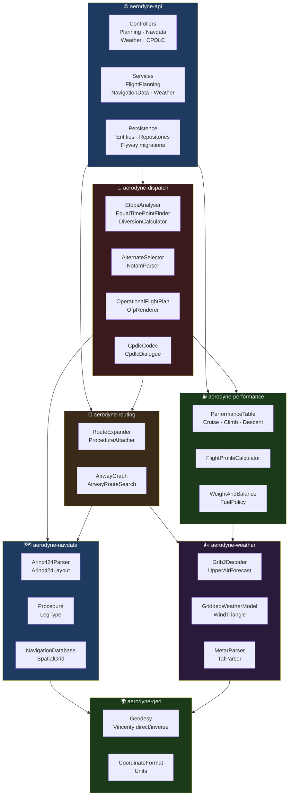
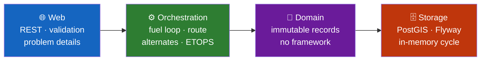
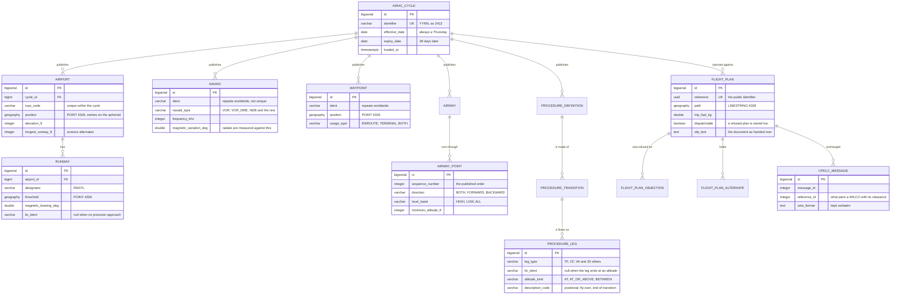
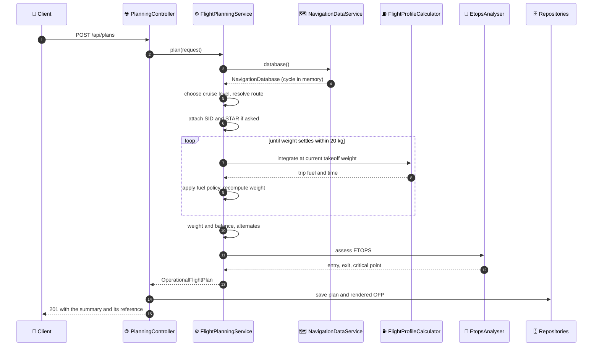
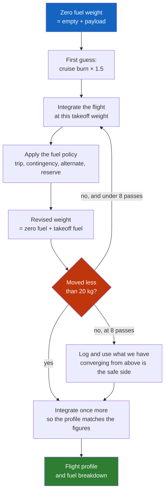
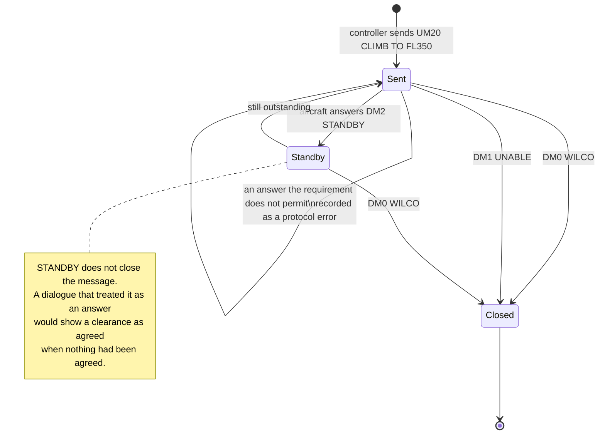
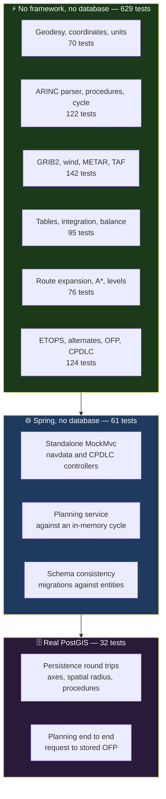

<div align="center">

**🌐 Choose Language / Selecione o Idioma / Elija el Idioma**

[](README.md)&nbsp;&nbsp;&nbsp;[](README_PT.md)&nbsp;&nbsp;&nbsp;[](README_ES.md)

</div>

---

<div align="center">

```
 █████╗ ███████╗██████╗  ██████╗ ██████╗ ██╗   ██╗███╗   ██╗███████╗
██╔══██╗██╔════╝██╔══██╗██╔═══██╗██╔══██╗╚██╗ ██╔╝████╗  ██║██╔════╝
███████║█████╗  ██████╔╝██║   ██║██║  ██║ ╚████╔╝ ██╔██╗ ██║█████╗
██╔══██║██╔══╝  ██╔══██╗██║   ██║██║  ██║  ╚██╔╝  ██║╚██╗██║██╔══╝
██║  ██║███████╗██║  ██║╚██████╔╝██████╔╝   ██║   ██║ ╚████║███████╗
╚═╝  ╚═╝╚══════╝╚═╝  ╚═╝ ╚═════╝ ╚═════╝    ╚═╝   ╚═╝  ╚═══╝╚══════╝
              Flight planning and dispatch engine
```

---


<br/>

> **A flight planning engine that computes what an aeroplane will actually burn, where it may divert, and whether it may go at all.**
> Geodesy, navigation data, upper winds, aircraft performance and dispatch rules, each solved from first principles rather than approximated.

<br/>


</div>

---

## 📑 Table of Contents

<details>
<summary>▶️ <strong>Click to expand / collapse this section</strong></summary>

<table>
<tr>
<td valign="top">

**🏗️ System**

- [🌟 Overview](#-overview)
- [🏗️ System Architecture](#️-system-architecture)
- [🛠️ Technology Stack](#️-technology-stack)
- [📁 Project Structure](#-project-structure)

**📦 Modules**

- [📦 System Modules](#-system-modules)
- [🗄️ Data Model](#️-data-model)
- [🔄 System Flows](#-system-flows)

</td>
<td valign="top">

**💼 Business**

- [💼 Business Rules](#-business-rules)
- [✅ Functional Requirements](#-functional-requirements)
- [⚡ Non-Functional Requirements](#-non-functional-requirements)

**📐 Design**

- [🎨 Design Patterns Applied](#-design-patterns-applied)

**🔐 Security & Ops**

- [🔐 Security](#-security)
- [🚀 Installation & Execution](#-installation--execution)
- [🧪 Automated Tests](#-automated-tests)
- [📊 Metrics & Monitoring](#-metrics--monitoring)
- [⚠️ Known Limitations](#️-known-limitations)

</td>
</tr>
</table>

---

</details>

## 🌟 Overview

<details>
<summary>▶️ <strong>Click to expand / collapse this section</strong></summary>

Aerodyne answers the questions an airline operations centre asks before a flight leaves. How much fuel does this aeroplane need to fly this route on this day, against these winds, at this weight? Where can it divert if an engine fails over the ocean? Is the destination forecast good enough to fly to without holding a second aerodrome in reserve? May it go at all?

None of those questions has a shortcut. The fuel figure depends on a wind field that varies in three dimensions and in time, on a weight that falls as the fuel burns, and on tables that are read against both. The diversion question depends on geodesic distances measured on an ellipsoid and on flying times that differ from distances because the wind blows. The dispatch question depends on rules that interact: a takeoff weight is bounded by the structure, by the zero-fuel limit plus the fuel on board, and by the landing limit plus the fuel that will burn off, and the lowest of the three wins.

The engine solves each of those from first principles. Vincenty's inverse solution rather than a spherical approximation. A GRIB2 decoder rather than a wind constant. An integration along the route rather than distance divided by speed. Everything below the web layer is plain Java with no framework in it, and is tested without one.

### 🎯 System Objectives

| | Objective | Description |
|---|---|---|
| 🌍 | **Measure the earth correctly** | Distances and courses on the WGS-84 ellipsoid, to the metre, because a published ETOPS distance has to be reproducible |
| 🗺️ | **Read the navigation database** | Parse ARINC 424 fixed-column records into airports, runways, navaids, waypoints, airways and terminal procedures |
| 🌬️ | **Use the real wind** | Decode GRIB2 upper-air forecasts and interpolate them in space, altitude and time |
| ⛽ | **Integrate the fuel** | Walk the route leg by leg, tracking weight down as fuel burns, against the wind at each point |
| ⚖️ | **Load the aeroplane** | Weight and balance with a certified centre-of-gravity envelope, checked as a polygon rather than a pair of limits |
| 🧭 | **Build the route** | Expand a filed route against the database, or search the airway network for one |
| 🛟 | **Plan the diversions** | ETOPS entry and exit points, equal-time points, and alternates screened on runway, weather and NOTAMs |
| 📄 | **Produce the document** | A fixed-width operational flight plan that a crew can cross-check against an FMS a line at a time |
| 🚫 | **Refuse when it must** | A plan that breaks a limit is computed, stored, and returned with the reasons it may not be flown |
| 🔁 | **Stay reproducible** | The same inputs give the same plan on every run and on every machine |

---

</details>

## 🏗️ System Architecture

<details>
<summary>▶️ <strong>Click to expand / collapse this section</strong></summary>

The engine is seven Maven modules in a strict dependency order. Nothing points upwards, and only the top module knows Spring exists. That is what lets the geodesy, the parsers and the fuel integration be tested in milliseconds without a container or a database.

### Module Diagram



### Architecture Layers



The orchestration layer is thin on purpose. `FlightPlanningService` performs no calculation of its own; what it owns is the order the steps run in, and one thing that is genuinely hard: the fuel loop. Takeoff weight determines fuel burn, and fuel burn determines the fuel on board, which is part of the takeoff weight. It is resolved by iterating to a fixed point, converging from an overestimate so that cutting it short errs in the safe direction.

---

</details>

## 🛠️ Technology Stack

<details>
<summary>▶️ <strong>Click to expand / collapse this section</strong></summary>

<table>
  <thead>
    <tr><th>Layer</th><th>Technology</th><th>Version</th><th>Purpose</th></tr>
  </thead>
  <tbody>
    <tr>
      <td rowspan="2"><b>Language &amp; build</b></td>
      <td>Java</td><td>21</td><td>Records, sealed switches, text blocks</td>
    </tr>
    <tr><td>Apache Maven</td><td>3.9</td><td>Seven-module reactor build</td></tr>
    <tr>
      <td rowspan="4"><b>Web</b></td>
      <td>Spring Boot</td><td>3.3.4</td><td>Application container and autoconfiguration</td>
    </tr>
    <tr><td>Spring Web MVC</td><td>6.1</td><td>REST controllers, RFC 7807 problem details</td></tr>
    <tr><td>Hibernate Validator</td><td>8.0</td><td>Request validation on the DTO records</td></tr>
    <tr><td>springdoc-openapi</td><td>2.6.0</td><td>OpenAPI document and Swagger UI</td></tr>
    <tr>
      <td rowspan="4"><b>Persistence</b></td>
      <td>PostgreSQL</td><td>16</td><td>System of record for cycles and plans</td>
    </tr>
    <tr><td>PostGIS</td><td>3.4</td><td>Geography columns, metre-accurate radius search</td></tr>
    <tr><td>Hibernate Spatial</td><td>6.5.3.Final</td><td>Mapping JTS geometries to PostGIS</td></tr>
    <tr><td>Flyway</td><td>10.17.3</td><td>Versioned schema migrations</td></tr>
    <tr>
      <td rowspan="3"><b>Libraries</b></td>
      <td>JTS Topology Suite</td><td>1.19.0</td><td>Point and linestring geometry types</td>
    </tr>
    <tr><td>Jackson Databind</td><td>2.17.2</td><td>JSON payloads and performance table files</td></tr>
    <tr><td>SLF4J</td><td>2.0.16</td><td>Logging facade in every module</td></tr>
    <tr>
      <td rowspan="3"><b>Testing</b></td>
      <td>JUnit Jupiter</td><td>5.11.0</td><td>Nested, parameterised and conditional tests</td>
    </tr>
    <tr><td>AssertJ</td><td>3.26.3</td><td>Fluent assertions with named failure context</td></tr>
    <tr><td>Testcontainers</td><td>1.21.3</td><td>Disposable PostGIS for integration tests</td></tr>
    <tr>
      <td rowspan="3"><b>Data formats</b></td>
      <td>ARINC 424-18</td><td>—</td><td>Navigation database records, fixed 132 columns</td>
    </tr>
    <tr><td>WMO GRIB2</td><td>—</td><td>Upper-air wind and temperature grids</td></tr>
    <tr><td>ICAO METAR / TAF / NOTAM</td><td>—</td><td>Aerodrome weather and closures</td></tr>
  </tbody>
</table>

> [!NOTE]
> No geospatial library is used for the navigation mathematics. Vincenty's solutions, the great-circle helpers and the coordinate parsers are implemented directly, because the accuracy contract matters more than the convenience.

---

</details>

## 🎨 Design Patterns Applied

<details>
<summary>▶️ <strong>Click to expand / collapse this section</strong></summary>

| Pattern | Where | Rationale |
|---|---|---|
| **Immutable value object** | `GeoPoint`, `WindVector`, `ProcedureLeg`, every domain record | Nothing in a computed plan may change under a caller. Records give equality, a constructor that validates, and thread safety without effort |
| **Strategy** | `WeatherModel` with `ConstantWeatherModel` and `GriddedWeatherModel` | The integration asks for wind at a point and does not care whether a forecast is loaded. Falling back to the standard atmosphere is a real answer, not a failure |
| **Builder** | `NavigationDatabase.Builder`, `GriddedWeatherModel.Builder`, `WeightAndBalance` | These aggregate several collections and must be immutable once built. A builder is what makes both possible |
| **Table-driven parsing** | `Arinc424Layout` | Every column offset lives in one file. A supplier variant is corrected by editing a constant, not by hunting through parsing code |
| **Two-model separation** | `NavigationEntities` against the domain records | Storage records are mutable and have identity. Domain records are immutable and have behaviour. Keeping them apart costs a mapping and buys a domain a test can build in one line |
| **Predictor-corrector** | `FlightProfileCalculator.cruiseLeg` | Fuel flow depends on weight and weight falls as fuel burns. Burning the leg twice, the second time at the mean weight, removes most of the bias |
| **Bisection search** | `EqualTimePointFinder` | The wind field is not smooth, so a method assuming smoothness could walk off a jet stream boundary. Bisection converges reliably on a continuous function |
| **A\* with an admissible heuristic** | `AirwayRouteSearch` | The great-circle distance never overestimates the route remaining, which is what makes the first completed route provably the shortest |
| **Null object** | `CpdlcArchive.NONE` | A protocol test must not need a database. The no-op archive is what lets the dialogue be tested on its own |
| **Provenance tagging** | `DataProvenance` on `AircraftType` | A plan on invented figures looks exactly like a plan on a flight manual. Carrying the provenance with the data is what lets the dispatch decision see the difference |

---

</details>

## 📁 Project Structure

<details>
<summary>▶️ <strong>Click to expand / collapse this section</strong></summary>

```
📂 aerodyne/
├── 📄 pom.xml                                  # Reactor build, seven modules, dependency management
│
├── 📂 aerodyne-geo/                            # Navigational geodesy, no dependencies but SLF4J
│   └── 📂 src/main/java/io/aerodyne/geo/
│       ├── 📄 Geodesy.java                     # Vincenty direct and inverse, great circle, rhumb, cross-track
│       ├── 📄 GeoPoint.java                    # A position, longitude normalised on construction
│       ├── 📄 Ellipsoid.java                   # WGS-84 and the constants Vincenty needs
│       ├── 📄 GeodesicSolution.java            # Distance, initial and final bearing, iterations used
│       ├── 📄 CoordinateFormat.java            # Six notations parsed, four rendered
│       └── 📄 Units.java                       # Nautical miles, feet, knots, ISA temperature and Mach
│
├── 📂 aerodyne-navdata/                        # The navigation database
│   ├── 📂 src/main/java/io/aerodyne/navdata/
│   │   ├── 📄 NavigationDatabase.java          # Indexed cycle, positional identifier resolution
│   │   ├── 📄 SpatialGrid.java                 # One-degree buckets for "what is near here"
│   │   ├── 📄 GridMora.java                    # One band of minimum off-route altitudes
│   │   ├── 📄 MinimumAltitudeGrid.java         # The whole grid, and the walk along a route
│   │   ├── 📄 AiracCycle.java                  # 28-day cycles from the 2001 epoch
│   │   ├── 📄 Airport.java 📄 Runway.java       # Aerodromes and landing directions
│   │   ├── 📄 Navaid.java 📄 Waypoint.java      # Radio aids and named positions
│   │   ├── 📄 Airway.java 📄 AirwayPoint.java   # Enroute airways and their legs
│   │   ├── 📂 arinc/                           # The fixed-column parser
│   │   │   ├── 📄 Arinc424Parser.java          # Record dispatch, accumulation, assembly
│   │   │   ├── 📄 Arinc424Layout.java          # Every column offset, in one file
│   │   │   └── 📄 Arinc424Diagnostic.java      # Detects a layout that does not fit the file
│   │   └── 📂 procedure/                       # SID, STAR and approach
│   │       ├── 📄 LegType.java                 # 23 path-and-terminator codes
│   │       ├── 📄 Procedure.java               # Segments joined into the legs flown
│   │       └── 📄 AltitudeConstraint.java      # At, above, below, and the window read correctly
│   └── 📂 src/test/resources/arinc/
│       ├── 📄 generate_fixture.py              # Generates the extract from the column map
│       └── 📄 extract.arinc                    # 41 records covering every supported type
│
├── 📂 aerodyne-weather/                        # Wind, temperature and aerodrome weather
│   └── 📂 src/main/java/io/aerodyne/weather/
│       ├── 📄 GriddedWeatherModel.java         # Interpolation in space, altitude and time
│       ├── 📄 LatLonGrid.java                  # Bilinear sampling with antimeridian wrap
│       ├── 📄 WindTriangle.java                # Heading and ground speed, solved as vectors
│       ├── 📄 StandardAtmosphere.java          # Isobaric surface to pressure altitude
│       ├── 📂 grib/                            # GRIB2
│       │   ├── 📄 Grib2Decoder.java            # Sections 0 to 8, templates 3.0, 4.0 and 5.0
│       │   └── 📄 UpperAirForecast.java        # Pairs the wind components, stacks the levels
│       └── 📂 metar/                           # Aerodrome reports
│           ├── 📄 MetarParser.java             # Every group of an observation
│           └── 📄 TafParser.java               # Prevailing against worst case
│
├── 📂 aerodyne-performance/                    # Aircraft performance and fuel
│   └── 📂 src/main/java/io/aerodyne/performance/
│       ├── 📄 FlightProfileCalculator.java     # The integration, leg by leg
│       ├── 📄 PerformanceTable.java            # Bilinear, clamped rather than extrapolated
│       ├── 📄 WeightAndBalance.java            # Moments about the datum, envelope checked
│       ├── 📄 FuelPolicy.java                  # Taxi, trip, contingency, alternate, reserve
│       ├── 📄 StepClimbPolicy.java             # When the cruise may step up, and by how much
│       ├── 📄 AircraftTypeLoader.java          # Reads an operator's own tables from JSON
│       └── 📄 AircraftTypes.java               # Two worked examples, marked as such
│
├── 📂 aerodyne-routing/                        # Route construction
│   └── 📂 src/main/java/io/aerodyne/routing/
│       ├── 📄 RouteExpander.java               # A filed route resolved against the database
│       ├── 📄 ProcedureAttacher.java           # Joins the SID and STAR onto the enroute route
│       ├── 📄 AirwayGraph.java                 # The network as it exists at one level
│       ├── 📄 AirwayRouteSearch.java           # A* with an admissible heuristic
│       ├── 📄 WindOptimalRouteSearch.java      # The same search, costed in time not distance
│       └── 📄 SemicircularRule.java            # Which levels a track may use
│
├── 📂 aerodyne-dispatch/                       # The dispatch decision
│   └── 📂 src/main/java/io/aerodyne/dispatch/
│       ├── 📄 EtopsAnalyser.java               # Entry, exit and the critical point
│       ├── 📄 EtopsAerodromeScreen.java        # Adequate against suitable, and which one it did
│       ├── 📄 EqualTimePointFinder.java        # Bisection on the difference in flying time
│       ├── 📄 AlternateSelector.java           # Runway, approach, forecast and NOTAM
│       ├── 📂 notam/ 📄 NotamParser.java        # Q line decoded, E line carried through
│       ├── 📂 ofp/ 📄 OfpRenderer.java          # The fixed-width document
│       └── 📂 cpdlc/ 📄 CpdlcCodec.java         # Message elements and the reference pairing
│
├── 📂 aerodyne-api/                            # Spring Boot application
│   ├── 📂 src/main/java/io/aerodyne/api/
│   │   ├── 📄 AerodyneApplication.java         # The only class that knows about Spring first
│   │   ├── 📂 web/                             # Four controllers, one exception handler
│   │   ├── 📂 service/                         # Orchestration, navdata cache, weather store
│   │   ├── 📂 persistence/                     # Entities, repositories, JTS conversion
│   │   └── 📂 dto/                             # Request and response records
│   └── 📂 src/main/resources/
│       ├── 📄 application.yml                  # Datasource, Flyway, JPA validate-only
│       └── 📂 db/migration/                    # V1 navigation data, V2 plans, V3 procedures
│
├── 📄 README.md                                # 🇺🇸 English (this file)
├── 📄 README_PT.md                             # 🇧🇷 Português
└── 📄 README_ES.md                             # 🇪🇸 Español
```

---

</details>

## 📦 System Modules

<details>
<summary>▶️ <strong>Click to expand / collapse this section</strong></summary>

### 🌍 aerodyne-geo

Navigational geodesy on the WGS-84 ellipsoid, with no external geospatial library. Two families of computation live here and they answer different questions. The ellipsoidal solutions are accurate to well under a metre and are used wherever a published distance must be reproduced. The spherical helpers are closed-form and cheap, and are what the route search calls in its inner loop.

| Responsibility | API | Notes |
|---|---|---|
| Ellipsoidal distance and bearings | `Geodesy.inverse(from, to)` | Raises `ArithmeticException` on a near-antipodal pair rather than returning a wrong answer |
| Position from bearing and distance | `Geodesy.direct(from, bearing, metres)` | Inverts the inverse solution to within 1e-8 degrees |
| Great circle and rhumb line | `greatCircleDistanceNm`, `rhumbDistanceNm` | Within 0.3 % of the ellipsoid, which the search heuristic tolerates |
| Track keeping | `crossTrackDistanceNm`, `alongTrackDistanceNm` | Signed, positive right of track |
| Coordinate notations | `CoordinateFormat.parseOrNull` | ARINC packed, degrees and decimal minutes, DMS, ICAO, oceanic shorthand, signed decimal |
| Unit conversion | `Units` | Nautical mile and foot exact by definition; ISA temperature and Mach to true airspeed |

---

### 🗺️ aerodyne-navdata

An ARINC 424 reader and an indexed database for one AIRAC cycle. The format is fixed-column, 132 characters per record, and the parser is deliberately forgiving: a navdata file is tens of megabytes of third-party text and a handful of unreadable records is routine. What it will not do is guess, so a record with no readable position is dropped rather than placed at the equator.

| Responsibility | API | Notes |
|---|---|---|
| Parse a cycle | `Arinc424Parser.parse(path)` | Airports, runways, VHF and NDB navaids, waypoints, airways, SID, STAR and approach |
| Detect a layout mismatch | `Arinc424Diagnostic.check(file)` | A failure rate above 25 % in a record type means the column map does not fit |
| Resolve an identifier | `NavigationDatabase.resolve(ident, near)` | Identifiers repeat worldwide, so the nearest candidate to the route wins |
| Find what is near | `fixesWithin`, `airportsWithin` | One-degree bucket grid, filtered by true distance |
| Read a procedure | `procedures(icao, type)` | Segments kept apart, joined by `Procedure.assemble` |
| Track the cycle | `AiracCycle.effectiveOn(date)` | 28-day cycles, every one starting on a Thursday |
| Clear the terrain | `minimumAltitudes().along(path, interval)` | Grid MORA along a route; an unsurveyed square answers unknown, never zero |

---

### 🌬️ aerodyne-weather

A GRIB2 decoder, an interpolating wind model, the wind triangle, and parsers for METAR, TAF and the standard atmosphere. GRIB2 is a container format and the decoder reads the subset that upper winds are published in: a regular latitude and longitude grid, an instantaneous forecast, and simple packing. Anything else is refused by name rather than misread, because a wind field decoded with the wrong unpacking looks plausible and is wrong.

| Responsibility | API | Notes |
|---|---|---|
| Decode a forecast | `Grib2Decoder.decode(bytes)` | Sections 0 to 8, sign-magnitude integers, n-bit unpacking |
| Assemble a model | `UpperAirForecast.assemble` | Pairs `UGRD` with `VGRD`, converts to knots and Celsius once |
| Sample the wind | `GriddedWeatherModel.at(point, altitude, time)` | Bilinear horizontally, on pressure altitude vertically, linear in time |
| Solve the triangle | `WindTriangle.solve(course, tas, wind)` | Vector solution; raises when the crosswind exceeds the airspeed |
| Read an observation | `MetarParser.parse(text)` | Wind, visibility in metres or statute miles, cloud, RVR, weather, pressure |
| Read a forecast | `TafParser.parse(text)` | `prevailingAt` and `worstCaseAt`, which differ and both matter |

---

### ⛽ aerodyne-performance

Aircraft tables, the fuel and time integration, weight and balance, and the fuel policy. The integration is where the engine earns its name: it walks the route in steps no longer than 100 nautical miles, samples the wind at each step's midpoint at the time the aircraft is there, and tracks the weight down as the fuel burns.

| Responsibility | API | Notes |
|---|---|---|
| Read a table | `PerformanceTable.valueAt(weight, altitude)` | Bilinear, clamped at the edges rather than extrapolated |
| Integrate a flight | `FlightProfileCalculator.compute(request)` | Climb, cruise and descent, with a predictor-corrector on each cruise leg |
| Step up as it lightens | `StepClimbPolicy.standard()` | A step is taken only when its fuel plus the cruise above costs less than the cruise below |
| Load the aeroplane | `WeightAndBalance.forType(type)` | Moments about the datum, centre of gravity as a percentage of chord |
| Check the envelope | `CentreOfGravityEnvelope.contains` | Ray casting, because the envelope is a polygon and not a rectangle |
| Apply the fuel policy | `FuelPolicy.apply(trip, alternate, additional, extra)` | Contingency with a holding floor, final reserve that may not be planned into |
| Load an operator's tables | `AircraftTypeLoader.load(path)` | JSON in the shape of the published tables, validated strictly |

---

### 🧭 aerodyne-routing

Route expansion, procedure attachment, and the airway search. A filed route is terse and most of what it says is implicit: `EGLL DCT KOLIN UN862 BEDEK DCT LEBL` names five things and describes a path through however many fixes `UN862` happens to cross.

| Responsibility | API | Notes |
|---|---|---|
| Expand a filed route | `RouteExpander.expand(route, from)` | Walks airways, skips speed and level groups, resolves positionally |
| Attach the procedures | `ProcedureAttacher.attach(...)` | Checks the join, drops legs with no position, reports both |
| Build the network | `AirwayGraph.build(database, altitude)` | Altitude baked in, so anything found is by construction filable |
| Search it for distance | `AirwayRouteSearch.search(from, to)` | A\* with the great-circle heuristic; the first route completed is the shortest |
| Search it for time | `WindOptimalRouteSearch.search(from, to)` | The same A\*, costed in minutes against the forecast, with a heuristic that stays admissible |
| Choose a level | `SemicircularRule.nearestAvailableLevel` | Odd eastbound, even westbound, 4000 ft apart above FL410 |

---

### 🛟 aerodyne-dispatch

ETOPS, equal-time points, alternate selection, NOTAM parsing, the OFP document, and the datalink codec. The distinction this module keeps carefully is between distance and time. An equal-time point is not an equal-distance point, and with a 100-knot wind on the track the two are a long way apart.

| Responsibility | API | Notes |
|---|---|---|
| Time a diversion | `DiversionCalculator.to(from, aerodrome, at)` | Wind sampled at the leg midpoint, at the engine-out level |
| Find an equal-time point | `EqualTimePointFinder.between(...)` | Bisection to half a minute; reports when the route holds no crossing |
| Assess ETOPS | `EtopsAnalyser.analyse(...)` | Entry, exit, critical point, and the approval the route would need |
| Screen alternates | `AlternateSelector.screen(...)` | Rejected candidates kept with their reasons, which is what a dispatcher needs |
| Screen en-route alternates | `EtopsAerodromeScreen.along(...)` | Adequate against suitable, and it says which of the two it managed |
| Decode a NOTAM | `NotamParser.parse(text)` | Q line decoded to subject and condition; the E line carried verbatim |
| Render the OFP | `OfpRenderer.render(plan)` | Column-aligned monospace, wrapped never truncated |
| Exchange datalink | `CpdlcCodec`, `CpdlcDialogue` | Reference pairing, and `STANDBY` correctly leaving a clearance open |

---

### 🌐 aerodyne-api

The Spring Boot application. It holds no planning logic. What it owns is persistence on PostGIS, the REST surface, and the orchestration that puts the modules in order.

| Endpoint | Method | Purpose |
|---|---|---|
| `/api/plans` | POST | Compute a plan and store it |
| `/api/plans/{reference}` | GET | The stored summary |
| `/api/plans/{reference}/ofp` | GET | The rendered document, served verbatim from storage |
| `/api/navdata/cycle` | GET | Which AIRAC cycle is loaded and how much is in it |
| `/api/navdata/fixes/{ident}` | GET | Everything published under an identifier |
| `/api/navdata/fixes` | GET | What is near a position, nearest first |
| `/api/navdata/airports/{icao}` | GET | An aerodrome and its runways |
| `/api/navdata/airports/{icao}/procedures` | GET | SID, STAR and approaches, legs as flown |
| `/api/navdata/route` | GET | Expand a route without planning against it |
| `/api/weather` | GET | What weather the engine holds |
| `/api/weather/metar` · `/taf` · `/notam` | POST | Submit a report as the text it arrives as |
| `/api/weather/upper-air` | POST | Upload a GRIB2 file |
| `/api/weather/upper-air/from-path` | POST | Load one from a path on the server |
| `/api/cpdlc/{aircraft}/messages` | POST | Send a clearance or a request |
| `/api/cpdlc/{aircraft}/outstanding` | GET | What is awaiting an answer |

---

</details>

## 💼 Business Rules

<details>
<summary>▶️ <strong>Click to expand / collapse this section</strong></summary>

### Fuel and weight

| # | Rule | Enforcement |
|---|---|---|
| BR-01 | The takeoff weight is the lowest of the structural limit, the zero-fuel limit plus fuel on board, and the landing limit plus trip fuel | `WeightLimits.maximumTakeoffWeightKg` |
| BR-02 | Contingency fuel is a percentage of trip fuel, with a floor expressed as minutes of holding | `FuelPolicy.apply` |
| BR-03 | The final reserve may never be planned into | `FuelBreakdown.protectsFinalReserve` |
| BR-04 | Ramp fuel above tank capacity refuses the dispatch | `OperationalFlightPlan.dispatchObjections` |
| BR-05 | A centre of gravity outside the envelope refuses the dispatch, at any of the three weights | `WeightAndBalance.checkCg` |
| BR-06 | A plan built on representative rather than manufacturer performance data may not be dispatched | `DataProvenance.isDispatchable` |

### Route and airspace

| # | Rule | Enforcement |
|---|---|---|
| BR-07 | An airway leg is usable only within its published level band and altitude limits | `AirwayPoint.permitsAltitude` |
| BR-08 | A one-way airway may not be flown against its direction | `Airway.between` |
| BR-09 | Eastbound magnetic tracks fly odd levels, westbound even, with 4000 ft spacing above FL410 | `SemicircularRule.isAvailable` |
| BR-10 | A repeated identifier resolves to the candidate nearest the route, and is refused when there is nothing to resolve against | `NavigationDatabase.resolve` |
| BR-11 | A procedure is attached only if it joins the route where the route begins or ends | `ProcedureAttacher.select` |
| BR-12 | A cruise level below the highest surveyed minimum off-route altitude on the route refuses dispatch | `OperationalFlightPlan.dispatchObjections` |

### Dispatch

| # | Rule | Enforcement |
|---|---|---|
| BR-12 | An alternate is held against the worst case of its forecast, not the prevailing conditions | `AlternateSelector.worstCaseAt` |
| BR-13 | An aerodrome with no forecast covering the arrival does not qualify as an alternate | `AlternateCriteria.requireCurrentWeather` |
| BR-14 | An aerodrome closed by an active NOTAM at the arrival time does not qualify | `AlternateSelector.assess` |
| BR-15 | A twin-engine route beyond the approved diversion time refuses the dispatch | `EtopsAnalysis.isCompliant` |
| BR-16 | A plan whose wind forecast does not cover the whole route refuses the dispatch | `FlightProfile.usedForecastWind` |
| BR-17 | A refused plan is still computed and stored, with its reasons | `PlanningController.plan` |
| BR-18 | An ETOPS route whose en-route alternates were never screened against a forecast refuses dispatch | `EtopsAnalysis.weatherScreened` |

---

</details>

## ✅ Functional Requirements

<details>
<summary>▶️ <strong>Click to expand / collapse this section</strong></summary>

| ID | Requirement | Priority | Status |
|---|---|---|---|
| RF-01 | Compute geodesic distance and bearings on WGS-84 | 🔴 High | ✅ Implemented |
| RF-02 | Parse and render the coordinate notations used in navigation data and filed routes | 🔴 High | ✅ Implemented |
| RF-03 | Read an ARINC 424 file into airports, runways, navaids, waypoints and airways | 🔴 High | ✅ Implemented |
| RF-04 | Read SID, STAR and approach procedures with their path-and-terminator legs | 🔴 High | ✅ Implemented |
| RF-05 | Detect and refuse an ARINC file the column map does not fit | 🟡 Medium | ✅ Implemented |
| RF-06 | Resolve an AIRAC cycle from a date and track its validity | 🟡 Medium | ✅ Implemented |
| RF-07 | Decode GRIB2 upper-air wind and temperature grids | 🔴 High | ✅ Implemented |
| RF-08 | Interpolate wind in latitude, longitude, altitude and time | 🔴 High | ✅ Implemented |
| RF-09 | Parse METAR and SPECI observations | 🔴 High | ✅ Implemented |
| RF-10 | Parse TAF forecasts, distinguishing prevailing from worst case | 🔴 High | ✅ Implemented |
| RF-11 | Parse NOTAMs and decode the Q line | 🟡 Medium | ✅ Implemented |
| RF-12 | Integrate fuel and time along a route against the forecast wind | 🔴 High | ✅ Implemented |
| RF-13 | Compute weight and balance against a certified envelope | 🔴 High | ✅ Implemented |
| RF-14 | Apply a regulatory fuel policy | 🔴 High | ✅ Implemented |
| RF-15 | Load an operator's own performance tables from a file | 🟡 Medium | ✅ Implemented |
| RF-16 | Expand a filed route against the navigation database | 🔴 High | ✅ Implemented |
| RF-17 | Search the airway network for a shortest route | 🟡 Medium | ✅ Implemented |
| RF-18 | Attach departure and arrival procedures to a route | 🟡 Medium | ✅ Implemented |
| RF-19 | Select a cruise level under the semicircular rule | 🟡 Medium | ✅ Implemented |
| RF-20 | Compute ETOPS entry, exit and critical points | 🔴 High | ✅ Implemented |
| RF-21 | Compute equal-time points between adequate aerodromes | 🔴 High | ✅ Implemented |
| RF-22 | Screen alternates on runway, approach, forecast and NOTAMs | 🔴 High | ✅ Implemented |
| RF-23 | Render an operational flight plan as a fixed-width document | 🔴 High | ✅ Implemented |
| RF-24 | Encode, decode and track a controller-pilot datalink exchange | 🟢 Low | ✅ Implemented |
| RF-25 | Persist cycles, plans, procedures and datalink messages on PostGIS | 🟡 Medium | ✅ Implemented |
| RF-26 | Optimise a route for wind rather than distance | 🟡 Medium | ✅ Implemented |
| RF-27 | Compute a step-climb profile as weight falls | 🟡 Medium | ✅ Implemented |
| RF-28 | Decode grid minimum off-route altitudes and check a route against them | 🟡 Medium | ✅ Implemented |
| RF-29 | Screen ETOPS en-route alternates on their forecasts, not runway length alone | 🔴 High | ✅ Implemented |
| RF-30 | Accept an upper-air forecast as an upload rather than a server path | 🟡 Medium | ✅ Implemented |

---

</details>

## ⚡ Non-Functional Requirements

<details>
<summary>▶️ <strong>Click to expand / collapse this section</strong></summary>

| ID | Category | Requirement | Target |
|---|---|---|---|
| RNF-01 | ⚡ Performance | Route search over the airway network | Under 200 000 expanded nodes, bounded by `nodeLimit` |
| RNF-02 | ⚡ Performance | Wind sampled often enough to cross a jet stream | No integration step longer than 100 nm |
| RNF-03 | ⚡ Performance | Fuel loop convergence | Settles within 20 kg, capped at 8 passes |
| RNF-04 | ⚡ Performance | Navigation data served from memory, not the database | One cycle held, swapped atomically |
| RNF-05 | 🎯 Accuracy | Ellipsoidal distance | Sub-metre against published Vincenty values |
| RNF-06 | 🎯 Accuracy | Spherical approximation used in the search | Within 0.3 % of the ellipsoid |
| RNF-07 | 🔁 Reproducibility | The same inputs give the same plan | Insertion-ordered maps throughout; no `Map.copyOf` where iteration order is read |
| RNF-08 | 🔁 Reproducibility | A plan can be recomputed against the data it used | Every cycle retained, referenced by the stored plan |
| RNF-09 | 🔐 Safety | Undecodable input is refused, never guessed at | GRIB2 packing, ARINC layout, CPDLC framing |
| RNF-10 | 🔐 Safety | Unreported weather does not satisfy a minimum | `SurfaceConditions.meets` |
| RNF-11 | 🧵 Concurrency | The navigation database and weather model are safe to share | Immutable, atomic reference swap |
| RNF-12 | 🧪 Testability | The engine is testable without a framework | 629 of 722 tests need no Spring context |
| RNF-13 | 🧪 Testability | The build is green without Docker | Integration tests skip cleanly |
| RNF-14 | 📦 Portability | Runs on any JVM 21 or later | No native or platform-specific code |
| RNF-15 | 🗄️ Data integrity | The schema is versioned and validated, never generated | Flyway migrations, `ddl-auto=validate` |
| RNF-16 | 📖 Observability | Every plan records the data it was built on | AIRAC cycle and wind source on the OFP |

---

</details>

## 🗄️ Data Model

<details>
<summary>▶️ <strong>Click to expand / collapse this section</strong></summary>

Eleven tables in three migrations. Every AIRAC cycle is kept rather than overwritten, because a plan has to be reproducible against the data it was built on and a plan filed last week cannot be checked against this week's cycle.

### Entity-Relationship Diagram



### Column type conventions

| Convention | Reason |
|---|---|
| `VARCHAR(n)`, never `CHAR(n)` | PostgreSQL blank-pads a `CHAR`, so a value read back does not equal the value written |
| `GEOGRAPHY`, never `GEOMETRY` | Geography measures in metres on the spheroid. Geometry would measure in degrees and be wrong by the cosine of the latitude |
| `DOUBLE PRECISION`, never `NUMERIC` | The domain works in doubles because these are physical quantities and not money |
| Cycle in the key of every navigation table | A plan must be reproducible against the cycle it used |

### In-memory structures

| Structure | Where it lives | Why not in the database |
|---|---|---|
| `NavigationDatabase` | One cycle, held by `NavigationDataService` | A route search asks "what is near here" at every expanded node; served from the database that would be tens of thousands of round trips per plan |
| `GriddedWeatherModel` | Loaded from a GRIB2 file | A forecast expires in hours and has no relational structure worth modelling |
| METAR, TAF and NOTAM store | `WeatherService` | Writing a row per minute per aerodrome to answer a question about the next two hours is the wrong shape |
| `CpdlcDialogue` | One per connected aircraft | What is outstanding is meaningful only while the aircraft is connected. What was said is archived |

---

</details>

## 🔄 System Flows

<details>
<summary>▶️ <strong>Click to expand / collapse this section</strong></summary>

### Planning a flight



### The fuel loop



### Importing a navigation cycle

```mermaid
sequenceDiagram
    autonumber
    participant O as 👤 Operator
    participant S as ⚙️ NavigationDataService
    participant P as 🗺️ Arinc424Parser
    participant G as 🔍 Arinc424Diagnostic
    participant R as 🗄️ PostGIS

    O->>S: importArinc(file)
    S->>P: parse
    P-->>S: objects, issues, and the cycle stamped on the records
    S->>G: check the layout
    alt failure rate over 25 % in a record type
        G-->>S: probable layout mismatch
        S-->>O: 400, naming the suspect record types
    else the column map fits
        G-->>S: ok
        S->>R: save cycle, airports, navaids, waypoints, airways, procedures
        Note over S,R: one transaction; a half-loaded cycle would be worse than none
        S->>S: load into memory, swap the reference atomically
        S-->>O: what was read and what was dropped
    end
```

### A datalink clearance



---

</details>

## 🔐 Security

<details>
<summary>▶️ <strong>Click to expand / collapse this section</strong></summary>

### Implemented Controls

| Control | Implementation | Effect |
|---|---|---|
| **Input validation on every request** | Jakarta Bean Validation on the DTO records, patterns for ICAO codes, runways and procedure identifiers | Malformed identifiers are refused before reaching the engine |
| **Parameterised queries only** | Spring Data derived queries and named parameters in the native spatial queries | No string concatenation reaches the database |
| **Schema validated, never generated** | `ddl-auto=validate` with Flyway owning the migrations | The ORM cannot silently alter a reviewed schema |
| **Error detail withheld from clients** | `server.error.include-message=never`, RFC 7807 problem details with curated text | Stack traces and internal paths stay in the log |
| **Refusal rather than interpretation** | GRIB2 unsupported packing, ARINC layout mismatch, CPDLC framing errors | Malformed third-party data cannot become a plausible wrong answer |
| **Provenance carried with performance data** | `DataProvenance` on `AircraftType` | A plan on unverified figures cannot be dispatched by accident |
| **Immutable domain objects** | Records throughout, defensive copies of every collection | A computed plan cannot be altered after the decision was made |
| **Actuator surface limited** | Only `health`, `info` and `metrics` exposed | No environment or configuration dump on the default port |

### Known Security Limitations

> [!WARNING]
> There is no authentication, no authorisation and no transport security in this repository. It is an engine, not a deployed service, and it must not be exposed to a network without the layer below being added first.

| Limitation | Risk | Mitigation path |
|---|---|---|
| No authentication on any endpoint | Anyone reachable can plan, import data and send datalink messages | Spring Security with OAuth2 resource server, roles for dispatch and for navdata import |
| No authorisation model | No separation between a dispatcher and an administrator | Method security on the import and CPDLC endpoints |
| No TLS configuration | Credentials and plans in clear text | Terminate TLS at the ingress, or configure the connector |
| GRIB2 loaded by a server-side path | A caller can name any path the process can read | Accept an upload, or restrict to a configured directory |
| Datasource password from an environment variable | Readable to anything that can read the process environment | A secret manager, or short-lived database credentials |
| No rate limiting | A planning request is expensive and can be repeated freely | A bucket per client at the ingress |
| No audit of who planned what | A stored plan records what and when, not who | An actor column on `flight_plan`, populated from the authenticated principal |

---

</details>

## 🚀 Installation & Execution

<details>
<summary>▶️ <strong>Click to expand / collapse this section</strong></summary>

### Prerequisites

| Requirement | Version | Notes |
|---|---|---|
| JDK | 21 or later | The build targets release 21 |
| Apache Maven | 3.9 or later | The wrapper is not committed |
| PostgreSQL with PostGIS | 16 with PostGIS 3.4 | Only for running the application, not for the unit tests |
| Docker | any recent | Only for the integration tests, and they skip without it |

### Build

```bash
# Compile and run every test that needs no database.
mvn clean test

# Build the whole reactor and install the modules locally.
mvn clean install

# Build only the engine, skipping the Spring Boot application.
mvn clean install -pl aerodyne-geo,aerodyne-navdata,aerodyne-weather,aerodyne-performance,aerodyne-routing,aerodyne-dispatch

# Package the runnable application.
mvn clean package -pl aerodyne-api -am
```

### Execution

```bash
# Start a PostGIS for development.
docker run -d --name aerodyne-db \
  -e POSTGRES_DB=aerodyne -e POSTGRES_USER=aerodyne -e POSTGRES_PASSWORD=aerodyne \
  -p 5432:5432 postgis/postgis:16-3.4

# Run the application. Flyway creates the schema on first start.
java -jar aerodyne-api/target/aerodyne-api-0.1.0.jar

# Or run it from the reactor with the development profile.
mvn spring-boot:run -pl aerodyne-api -Dspring-boot.run.profiles=dev

# Point it at your own aircraft performance tables.
java -Daerodyne.performance.directory=/etc/aerodyne/aircraft \
  -jar aerodyne-api/target/aerodyne-api-0.1.0.jar
```

```bash
# Check what is loaded.
curl -s localhost:8080/api/navdata/cycle

# Expand a route without planning against it.
curl -s "localhost:8080/api/navdata/route?route=EGLL%20OCK%20UN862%20BEDEK&from=EGLL"

# Plan a flight.
curl -s -X POST localhost:8080/api/plans -H 'Content-Type: application/json' -d '{
  "flightNumber": "AD101", "registration": "G-ABCD", "aircraftType": "N738",
  "departure": "EGLL", "destination": "LEBL",
  "cruiseFlightLevel": 350, "offBlocks": "2025-01-05T09:00:00Z",
  "payloadKg": 12000, "extraFuelKg": 0
}'

# Load a forecast, then plan the quickest route through it rather than the shortest,
# stepping up as the fuel burns off. Both are opt-in: a plan that did not ask for them
# gets the same answer it always did.
curl -s -X POST localhost:8080/api/weather/upper-air -F 'file=@gfs.t00z.pgrb2.grib2'

curl -s -X POST localhost:8080/api/plans -H 'Content-Type: application/json' -d '{
  "flightNumber": "AD102", "registration": "G-ABCD", "aircraftType": "N738",
  "departure": "EIDW", "destination": "KBOS",
  "cruiseFlightLevel": 310, "offBlocks": "2025-01-05T09:00:00Z",
  "payloadKg": 12000, "extraFuelKg": 0,
  "windOptimalRoute": true, "stepClimb": true
}'

# Fetch the rendered document.
curl -s localhost:8080/api/plans/<reference>/ofp
```

### Build targets

| Command | Effect |
|---|---|
| `mvn test` | Unit tests across all seven modules |
| `mvn verify` | Tests plus packaging |
| `mvn -pl aerodyne-geo test` | One module in isolation |
| `mvn -Dtest=GeodesyTest test` | One test class |
| `mvn spring-boot:run -pl aerodyne-api` | Run the application from source |

### Build configuration

| Property | Value | Purpose |
|---|---|---|
| `maven.compiler.release` | 21 | Language and API level |
| `AERODYNE_DB_URL` | `jdbc:postgresql://localhost:5432/aerodyne` | Datasource |
| `AERODYNE_DB_USER` · `AERODYNE_DB_PASSWORD` | `aerodyne` | Credentials |
| `AERODYNE_PORT` | 8080 | Listening port |
| `aerodyne.performance.directory` | unset | Directory of aircraft table files; the worked examples are used when unset |
| `AERODYNE_TEST_DB_URL` | unset | Points the integration tests at an existing database instead of starting a container |

---

</details>

## 🧪 Automated Tests

<details>
<summary>▶️ <strong>Click to expand / collapse this section</strong></summary>

722 tests, all passing. 629 of them need no Spring context and no database, which is what keeps the whole suite under ten seconds.

### Test Architecture



### Test suites

| Suite | Module | Tests | What it pins down |
|---|---|---|---|
| `GeodesyTest` | geo | 22 | Vincenty against published values, symmetry, the antipodal refusal |
| `CoordinateFormatTest` | geo | 36 | Six notations parsed, round trips, the minute-carry on rendering |
| `Arinc424ParserTest` | navdata | 33 | Every supported record type, and the malformed cases it survives |
| `ProcedureParsingTest` | navdata | 29 | Leg types, altitude windows, the route-type inversion between SID and STAR |
| `Arinc424DiagnosticTest` | navdata | 6 | A file written to a shifted column map is caught |
| `GridMoraTest` | navdata | 22 | An unsurveyed square answers unknown; a short record does not shift west |
| `Grib2DecoderTest` | weather | 18 | Round trip through an independently written encoder |
| `MetarParserTest` · `TafParserTest` | weather | 52 | Wind, visibility units, ceilings, prevailing against worst case |
| `FlightProfileCalculatorTest` | performance | 19 | Phase split, monotonic weight, wind and temperature effects |
| `StepClimbTest` | performance | 18 | A long sector steps and burns less; a short one declines the step |
| `AircraftTypeLoaderTest` | performance | 17 | A loaded type plans identically to the built-in one |
| `AirwayRouteSearchTest` | routing | 15 | Shortest route, level filtering, one-way airways |
| `WindOptimalRouteSearchTest` | routing | 13 | It flies round a headwind the distance search flies through, and nothing offered is quicker |
| `ProcedureAttacherTest` | routing | 11 | The join is checked, unresolvable legs reported |
| `EtopsTest` | dispatch | 27 | Equal-time points move with the wind; entry, exit and critical point |
| `EtopsAerodromeScreenTest` | dispatch | 10 | Adequate against suitable, and the fallback says which one it did |
| `CpdlcTest` | dispatch | 34 | Wire format, and STANDBY leaving a clearance open |
| `PostgisIntegrationTest` | api | 24 | Axis order, metre radii, procedure and datalink round trips |
| `PlanningControllerIntegrationTest` | api | 8 | Request to stored OFP, against a real database |

### Running the Tests

```bash
# Everything that needs no database. The integration tests skip cleanly.
mvn clean test

# With Testcontainers, if the Docker API is reachable.
mvn clean test   # the integration tests start their own PostGIS

# Against a database you started yourself, which is what to use where
# Testcontainers cannot reach the Docker API.
docker run -d --name aerodyne-test-db \
  -e POSTGRES_DB=aerodyne -e POSTGRES_USER=aerodyne -e POSTGRES_PASSWORD=aerodyne \
  -p 15432:5432 postgis/postgis:16-3.4

AERODYNE_TEST_DB_URL=jdbc:postgresql://localhost:15432/aerodyne \
AERODYNE_TEST_DB_USER=aerodyne AERODYNE_TEST_DB_PASSWORD=aerodyne \
  mvn clean test

# Regenerate the ARINC fixture after changing the column map.
cd aerodyne-navdata/src/test/resources/arinc && python generate_fixture.py
```

### Manual acceptance checklist

| # | Check | Expected |
|---|---|---|
| 1 | Import an ARINC 424 cycle | Counts reported, layout check passes, cycle becomes current |
| 2 | `GET /api/navdata/cycle` | Identifier, effective and expiry dates, object counts |
| 3 | Expand a route with a bad fix | 200 with the fix dropped and a warning naming it |
| 4 | Plan with no weather loaded | Plan computed, wind source reported as ISA |
| 5 | Plan with the example aircraft | Refused, with the provenance objection |
| 6 | Submit a TAF below minima, then plan | Alternate rejected with the shortfall named |
| 7 | Fetch the OFP | Fixed-width document, no line over 100 characters |
| 8 | Send a clearance and answer STANDBY | Still outstanding, no protocol error |

---

</details>

## 📊 Metrics & Monitoring

<details>
<summary>▶️ <strong>Click to expand / collapse this section</strong></summary>

### Codebase metrics

| Metric | Value |
|---|---|
| Maven modules | 7 |
| Java files (main) | 141 |
| Java files (test) | 42 |
| Java lines | 27 354 |
| SQL lines (migrations) | 288 |
| Database tables | 11 |
| Flyway migrations | 3 |
| REST endpoints | 25 |
| Tests | 722 |
| Tests needing no framework | 629 |
| Tests needing a database | 32 |

### Test distribution by module

| Module | Main files | Main lines | Tests |
|---|---|---|---|
| `aerodyne-geo` | 6 | 830 | 70 |
| `aerodyne-navdata` | 34 | 3 987 | 122 |
| `aerodyne-weather` | 24 | 2 819 | 142 |
| `aerodyne-performance` | 21 | 2 308 | 95 |
| `aerodyne-routing` | 9 | 1 447 | 76 |
| `aerodyne-dispatch` | 20 | 2 638 | 124 |
| `aerodyne-api` | 27 | 3 609 | 93 |

### Runtime signals

| Signal | Where | What it tells you |
|---|---|---|
| `loaded AIRAC {} in {} ms` | `NavigationDataService` | Cycle load time and object counts |
| `layout check for {}` | `NavigationDataService` | Per-record-type failure rates on import |
| `no performance directory configured` | `AircraftTypeRegistry` | The engine is using the example tables |
| `the fuel loop did not settle` | `FlightPlanningService` | Convergence failed within 8 passes |
| `no airway route from {} to {}` | `FlightPlanningService` | Planning direct because the network had nothing |
| `dropping the {} hPa level` | `UpperAirForecast` | A GRIB2 level had only one wind component |
| `/actuator/health` | Spring Actuator | Datasource reachability |

### Diagnostic commands

```bash
# What is loaded, and how much of it.
curl -s localhost:8080/api/navdata/cycle | jq

# What weather the engine holds.
curl -s localhost:8080/api/weather | jq

# Which aircraft it can plan for.
curl -s localhost:8080/api/plans -X POST -H 'Content-Type: application/json' \
  -d '{"aircraftType":"ZZZZ","departure":"EGLL","destination":"LEBL","offBlocks":"2025-01-05T09:00:00Z"}' | jq .detail

# Whether the schema matches the entities, without a database.
mvn -pl aerodyne-api test -Dtest=SchemaConsistencyTest

# Rows per table.
docker exec aerodyne-db psql -U aerodyne -d aerodyne -c "
  select relname, n_live_tup from pg_stat_user_tables order by n_live_tup desc;"
```

### Status codes

| Code | Meaning | Raised by |
|---|---|---|
| 200 | The request succeeded | Every GET |
| 201 | A plan was computed and stored, dispatchable or not | `POST /api/plans` |
| 400 | The request cannot be planned, or the submitted data could not be read | Unknown aerodrome, unknown type, malformed METAR or CPDLC line |
| 404 | No such plan, session, aerodrome or report | Reference or identifier lookups |
| 500 | An unanticipated failure, logged in full | Anything unhandled |
| 503 | No navigation data is loaded | Any endpoint needing a cycle before one is imported |

---

</details>

## ⚠️ Known Limitations

<details>
<summary>▶️ <strong>Click to expand / collapse this section</strong></summary>

> [!IMPORTANT]
> Two limitations are about data rather than code, and no amount of implementation removes them. The performance tables shipped with the engine are constructed, not from a flight manual. The ARINC 424 column map follows the published specification but has not been checked against the specification document itself. Both are visible rather than hidden: a plan on the example tables is refused, and a file the column map does not fit is refused on import.

| Category | Issue | Status |
|---|---|---|
| 📊 Data | The built-in aircraft tables are representative, not manufacturer data | ➕ Intentional, and a plan on them is refused |
| 📊 Data | The ARINC column map is unverified against the specification document | ⚠️ Open, mitigated by `Arinc424Diagnostic` |
| 🗺️ Navdata | Airspace boundaries and restricted areas are counted but not decoded | ⚠️ Open |
| 🗺️ Navdata | Grid MORA is decoded, and a cruise level below it refuses dispatch | ✅ Done |
| 🌬️ Weather | GRIB2 complex packing and JPEG 2000 are refused rather than decoded | ➕ Intentional, refusing beats misreading |
| 🌬️ Weather | A GRIB2 bitmap of missing values is refused | ➕ Intentional, interpolating across a hole would fabricate a wind |
| 🧭 Routing | The search can optimise time against the wind, not only distance | ✅ Done, `WindOptimalRouteSearch`, opt-in per request |
| ⛽ Performance | The cruise can step up as weight falls | ✅ Done, `StepClimbPolicy`, opt-in per request |
| ⛽ Performance | A step is decided on fuel over the remaining cruise, so the wind is in it | ➕ Intentional, a higher level with a worse wind can lose |
| ⚖️ Balance | Fuel is one station with a fixed arm, so the landing centre of gravity is a planning value | ➕ Intentional, the departure figures do not depend on it |
| 🛟 Dispatch | ETOPS en-route alternates are screened on their forecasts where there is one | ✅ Done, and a route screened on runway length alone refuses dispatch |
| 🔐 Security | No authentication, authorisation or transport security | ⚠️ Open, see the security section |
| 🌐 API | GRIB2 arrives as an upload; the path form is kept for a feed-fed installation | ✅ Done, though the path form still needs authentication in front of it |
| 🔁 Determinism | Iteration order was randomised by `Map.copyOf`, making equal-cost routes vary between runs | ✅ Fixed |
| 🗄️ Schema | `CHAR`, `GEOMETRY` and `NUMERIC` columns disagreed with the entities | ✅ Fixed, caught by the integration test |
| 🗺️ Navdata | The positional description code was read trimmed, losing the fly-over flag | ✅ Fixed |

> [!TIP]
> Wind-optimal routing, step climbs, grid MORA and forecast-screened ETOPS alternates are now built, so the highest-value item left is the one they all rest on: **the aircraft tables**. Every figure the engine produces is only as good as the performance data behind it, and the tables shipped here are constructed rather than taken from a flight manual — which is why a plan on them is refused rather than merely footnoted. `AircraftTypeLoader` already reads an operator's own tables from JSON and validates them strictly, so closing this needs no code at all: it needs the data. After that, the largest remaining piece of engineering is authentication, because nothing else on the list matters if the service cannot safely be exposed.

---

</details>

---

<div align="center">

---

### ✈️ Aerodyne

*Compute what the aeroplane will actually do, not what it would do in still air.*


<br/>

```
"The wind does not care what the chart says the distance is.
 Plan for the air the aeroplane will actually fly through."
```

</div>
