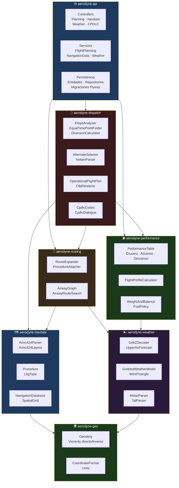
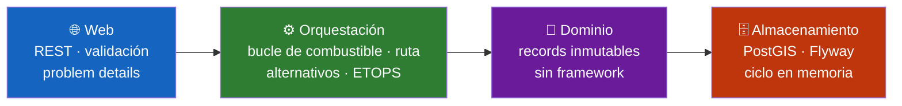
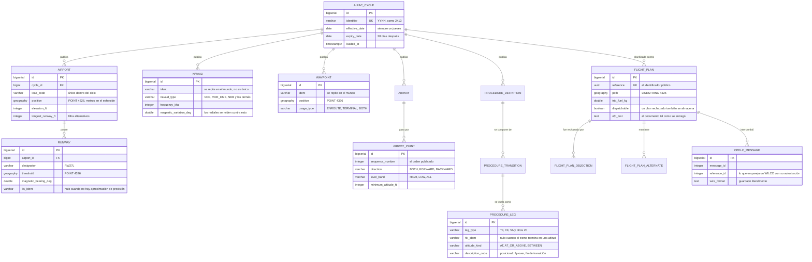
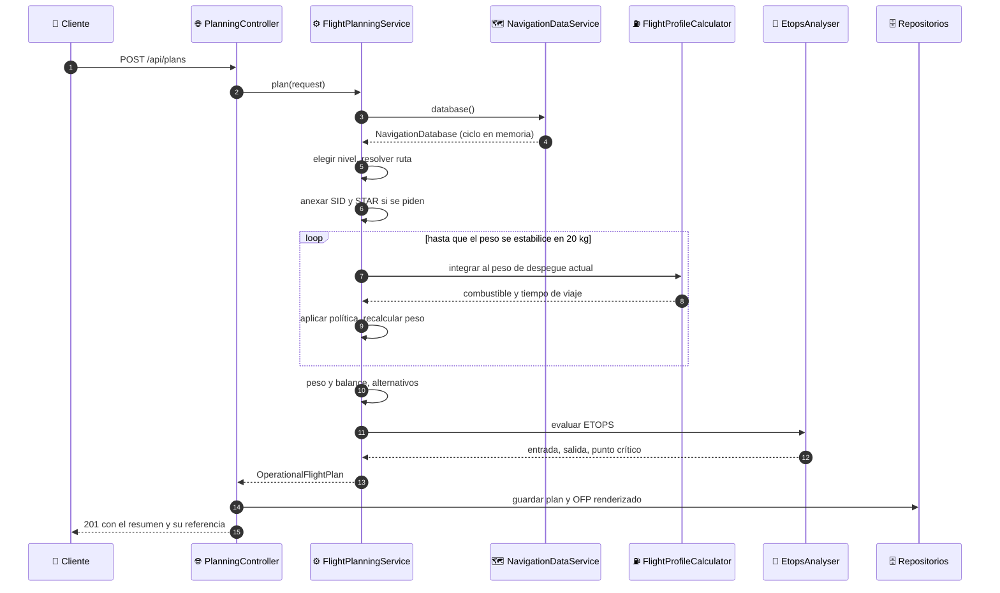
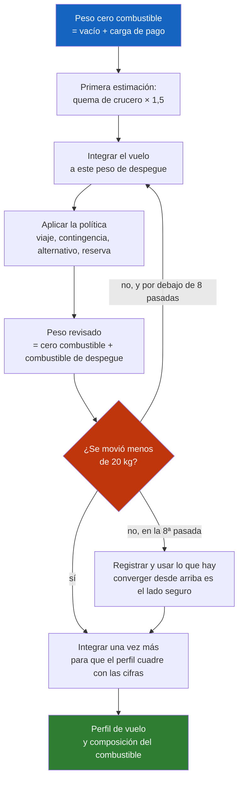
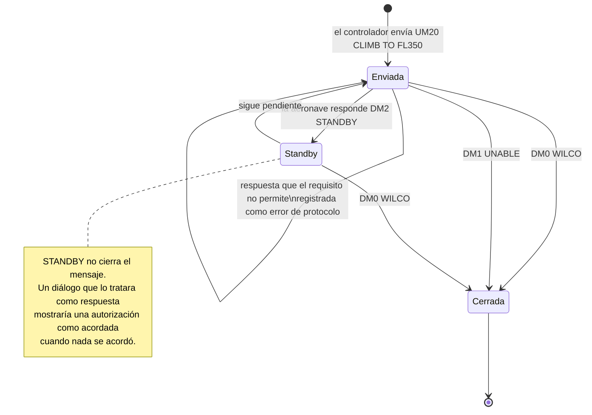
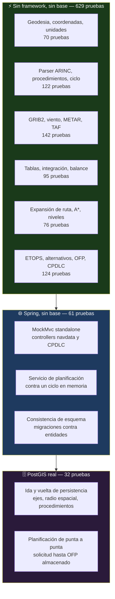

<div align="center">

**🌐 Choose Language / Selecione o Idioma / Elija el Idioma**

[](README.md)&nbsp;&nbsp;&nbsp;[](README_PT.md)&nbsp;&nbsp;&nbsp;[](README_ES.md)

</div>

---

<div align="center">

```
 █████╗ ███████╗██████╗  ██████╗ ██████╗ ██╗   ██╗███╗   ██╗███████╗
██╔══██╗██╔════╝██╔══██╗██╔═══██╗██╔══██╗╚██╗ ██╔╝████╗  ██║██╔════╝
███████║█████╗  ██████╔╝██║   ██║██║  ██║ ╚████╔╝ ██╔██╗ ██║█████╗
██╔══██║██╔══╝  ██╔══██╗██║   ██║██║  ██║  ╚██╔╝  ██║╚██╗██║██╔══╝
██║  ██║███████╗██║  ██║╚██████╔╝██████╔╝   ██║   ██║ ╚████║███████╗
╚═╝  ╚═╝╚══════╝╚═╝  ╚═╝ ╚═════╝ ╚═════╝    ╚═╝   ╚═╝  ╚═══╝╚══════╝
        Motor de planificación de vuelo y despacho aeronáutico
```

---


<br/>

> **Un motor de planificación de vuelo que calcula lo que la aeronave va a quemar realmente, adónde puede desviarse y si puede despegar.**
> Geodesia, datos de navegación, vientos en altura, performance de aeronave y reglas de despacho, cada uno resuelto desde los principios en lugar de aproximado.

<br/>


</div>

---

## 📑 Tabla de Contenidos

<details>
<summary>▶️ <strong>Haga clic para expandir / contraer esta sección</strong></summary>

<table>
<tr>
<td valign="top">

**🏗️ Sistema**

- [🌟 Visión General](#-visión-general)
- [🏗️ Arquitectura del Sistema](#️-arquitectura-del-sistema)
- [🛠️ Stack Tecnológico](#️-stack-tecnológico)
- [📁 Estructura del Proyecto](#-estructura-del-proyecto)

**📦 Módulos**

- [📦 Módulos del Sistema](#-módulos-del-sistema)
- [🗄️ Modelo de Datos](#️-modelo-de-datos)
- [🔄 Flujos del Sistema](#-flujos-del-sistema)

</td>
<td valign="top">

**💼 Negocio**

- [💼 Reglas de Negocio](#-reglas-de-negocio)
- [✅ Requisitos Funcionales](#-requisitos-funcionales)
- [⚡ Requisitos No Funcionales](#-requisitos-no-funcionales)

**📐 Diseño**

- [🎨 Patrones de Diseño Aplicados](#-patrones-de-diseño-aplicados)

**🔐 Seguridad & Operación**

- [🔐 Seguridad](#-seguridad)
- [🚀 Instalación & Ejecución](#-instalación--ejecución)
- [🧪 Pruebas Automatizadas](#-pruebas-automatizadas)
- [📊 Métricas & Monitoreo](#-métricas--monitoreo)
- [⚠️ Limitaciones Conocidas](#️-limitaciones-conocidas)

</td>
</tr>
</table>

---

</details>

## 🌟 Visión General

<details>
<summary>▶️ <strong>Haga clic para expandir / contraer esta sección</strong></summary>

Aerodyne responde las preguntas que un centro de operaciones de una aerolínea hace antes de que un vuelo salga. ¿Cuánto combustible necesita esta aeronave para volar esta ruta en este día, contra estos vientos, con este peso? ¿Adónde se desvía si un motor falla sobre el océano? ¿El pronóstico del destino es lo bastante bueno para volar sin mantener un segundo aeródromo de reserva? ¿Puede despegar?

Ninguna de esas preguntas tiene atajo. La cifra de combustible depende de un campo de viento que varía en tres dimensiones y en el tiempo, de un peso que cae conforme el combustible se quema, y de tablas leídas contra ambos. La pregunta del desvío depende de distancias geodésicas medidas sobre un elipsoide y de tiempos de vuelo que difieren de las distancias porque el viento sopla. La pregunta del despacho depende de reglas que interactúan: un peso de despegue está acotado por la estructura, por el límite de peso cero combustible más el combustible a bordo, y por el límite de aterrizaje más el combustible que se va a quemar, y el menor de los tres gana.

El motor resuelve cada uno de ellos desde los principios. La solución inversa de Vincenty en lugar de una aproximación esférica. Un decodificador GRIB2 en lugar de una constante de viento. Una integración a lo largo de la ruta en lugar de distancia dividida por velocidad. Todo lo que está debajo de la capa web es Java puro, sin framework alguno, y se prueba sin uno.

### 🎯 Objetivos del Sistema

| | Objetivo | Descripción |
|---|---|---|
| 🌍 | **Medir la Tierra correctamente** | Distancias y rumbos sobre el elipsoide WGS-84, al metro, porque una distancia ETOPS publicada tiene que ser reproducible |
| 🗺️ | **Leer la base de navegación** | Interpretar registros de columna fija ARINC 424 en aeropuertos, pistas, radioayudas, waypoints, aerovías y procedimientos terminales |
| 🌬️ | **Usar el viento real** | Decodificar pronósticos GRIB2 en altura e interpolarlos en el espacio, la altitud y el tiempo |
| ⛽ | **Integrar el combustible** | Recorrer la ruta tramo a tramo, siguiendo la caída del peso conforme el combustible se quema, contra el viento en cada punto |
| ⚖️ | **Cargar la aeronave** | Peso y balance con envolvente de centro de gravedad certificada, verificada como polígono y no como par de límites |
| 🧭 | **Construir la ruta** | Expandir una ruta presentada contra la base, o buscar una en la red de aerovías |
| 🛟 | **Planificar los desvíos** | Puntos de entrada y salida ETOPS, puntos de tiempo igual, y alternativos filtrados por pista, meteorología y NOTAM |
| 📄 | **Producir el documento** | Un plan operacional de vuelo de ancho fijo que la tripulación coteja contra un FMS línea por línea |
| 🚫 | **Rechazar cuando debe** | Un plan que rompe un límite se calcula, se almacena y se devuelve con las razones por las que no puede volar |
| 🔁 | **Seguir siendo reproducible** | Las mismas entradas dan el mismo plan en cada ejecución y en cada máquina |

---

</details>

## 🏗️ Arquitectura del Sistema

<details>
<summary>▶️ <strong>Haga clic para expandir / contraer esta sección</strong></summary>

El motor son siete módulos Maven en orden estricto de dependencia. Nada apunta hacia arriba, y solo el módulo de arriba sabe que Spring existe. Eso es lo que permite probar la geodesia, los parsers y la integración de combustible en milisegundos, sin contenedor y sin base de datos.

### Diagrama de Módulos



### Capas de la Arquitectura



La capa de orquestación es delgada a propósito. `FlightPlanningService` no hace cálculo propio; lo que posee es el orden en que corren los pasos, y una cosa genuinamente difícil: el bucle del combustible. El peso de despegue determina la quema, y la quema determina el combustible a bordo, que es parte del peso de despegue. Se resuelve iterando hasta un punto fijo, convergiendo desde una sobreestimación, de modo que cortarlo temprano yerra hacia el lado seguro.

---

</details>

## 🛠️ Stack Tecnológico

<details>
<summary>▶️ <strong>Haga clic para expandir / contraer esta sección</strong></summary>

<table>
  <thead>
    <tr><th>Capa</th><th>Tecnología</th><th>Versión</th><th>Propósito</th></tr>
  </thead>
  <tbody>
    <tr>
      <td rowspan="2"><b>Lenguaje y build</b></td>
      <td>Java</td><td>21</td><td>Records, switches sellados, text blocks</td>
    </tr>
    <tr><td>Apache Maven</td><td>3.9</td><td>Build reactor de siete módulos</td></tr>
    <tr>
      <td rowspan="4"><b>Web</b></td>
      <td>Spring Boot</td><td>3.3.4</td><td>Contenedor de la aplicación y autoconfiguración</td>
    </tr>
    <tr><td>Spring Web MVC</td><td>6.1</td><td>Controllers REST, problem details RFC 7807</td></tr>
    <tr><td>Hibernate Validator</td><td>8.0</td><td>Validación de solicitud en los records de DTO</td></tr>
    <tr><td>springdoc-openapi</td><td>2.6.0</td><td>Documento OpenAPI y Swagger UI</td></tr>
    <tr>
      <td rowspan="4"><b>Persistencia</b></td>
      <td>PostgreSQL</td><td>16</td><td>Sistema de registro de ciclos y planes</td>
    </tr>
    <tr><td>PostGIS</td><td>3.4</td><td>Columnas geography, búsqueda por radio en metros</td></tr>
    <tr><td>Hibernate Spatial</td><td>6.5.3.Final</td><td>Mapeo de geometrías JTS a PostGIS</td></tr>
    <tr><td>Flyway</td><td>10.17.3</td><td>Migraciones versionadas de esquema</td></tr>
    <tr>
      <td rowspan="3"><b>Bibliotecas</b></td>
      <td>JTS Topology Suite</td><td>1.19.0</td><td>Tipos geométricos punto y linestring</td>
    </tr>
    <tr><td>Jackson Databind</td><td>2.17.2</td><td>Payloads JSON y archivos de tabla de performance</td></tr>
    <tr><td>SLF4J</td><td>2.0.16</td><td>Fachada de log en todos los módulos</td></tr>
    <tr>
      <td rowspan="3"><b>Pruebas</b></td>
      <td>JUnit Jupiter</td><td>5.11.0</td><td>Pruebas anidadas, parametrizadas y condicionales</td>
    </tr>
    <tr><td>AssertJ</td><td>3.26.3</td><td>Aserciones fluidas con contexto de fallo nombrado</td></tr>
    <tr><td>Testcontainers</td><td>1.21.3</td><td>PostGIS desechable para pruebas de integración</td></tr>
    <tr>
      <td rowspan="3"><b>Formatos de datos</b></td>
      <td>ARINC 424-18</td><td>—</td><td>Registros de la base de navegación, 132 columnas fijas</td>
    </tr>
    <tr><td>WMO GRIB2</td><td>—</td><td>Rejillas de viento y temperatura en altura</td></tr>
    <tr><td>ICAO METAR / TAF / NOTAM</td><td>—</td><td>Meteorología y cierres de aeródromo</td></tr>
  </tbody>
</table>

> [!NOTE]
> No se usa ninguna biblioteca geoespacial en la matemática de navegación. Las soluciones de Vincenty, los auxiliares de círculo máximo y los parsers de coordenada están implementados directamente, porque el contrato de precisión importa más que la conveniencia.

---

</details>

## 🎨 Patrones de Diseño Aplicados

<details>
<summary>▶️ <strong>Haga clic para expandir / contraer esta sección</strong></summary>

| Patrón | Dónde | Justificación |
|---|---|---|
| **Objeto de valor inmutable** | `GeoPoint`, `WindVector`, `ProcedureLeg`, todos los records de dominio | Nada en un plan calculado puede cambiar bajo un llamador. Los records dan igualdad, constructor que valida y seguridad entre hilos sin esfuerzo |
| **Strategy** | `WeatherModel` con `ConstantWeatherModel` y `GriddedWeatherModel` | La integración pide el viento en un punto y no le importa si hay pronóstico cargado. Caer a la atmósfera estándar es una respuesta real, no un fallo |
| **Builder** | `NavigationDatabase.Builder`, `GriddedWeatherModel.Builder`, `WeightAndBalance` | Estos agregan varias colecciones y deben ser inmutables una vez construidos. El builder es lo que hace ambas cosas posibles |
| **Parsing dirigido por tabla** | `Arinc424Layout` | Todo desplazamiento de columna vive en un archivo. Una variante de proveedor se corrige editando una constante, no rastreando el código de parsing |
| **Separación de dos modelos** | `NavigationEntities` contra los records de dominio | Los registros de almacenamiento son mutables y tienen identidad. Los records de dominio son inmutables y tienen comportamiento. Mantenerlos aparte cuesta un mapeo y compra un dominio que una prueba construye en una línea |
| **Predictor-corrector** | `FlightProfileCalculator.cruiseLeg` | El consumo depende del peso y el peso cae conforme el combustible se quema. Quemar el tramo dos veces, la segunda al peso medio, elimina la mayor parte del sesgo |
| **Búsqueda por bisección** | `EqualTimePointFinder` | El campo de viento no es suave, así que un método que asumiera suavidad podría salirse de un borde de corriente en chorro. La bisección converge de forma fiable en una función continua |
| **A\* con heurística admisible** | `AirwayRouteSearch` | La distancia de círculo máximo nunca sobreestima la ruta restante, y eso es lo que hace que la primera ruta completada sea demostrablemente la más corta |
| **Objeto nulo** | `CpdlcArchive.NONE` | Una prueba de protocolo no debe necesitar base de datos. El archivo no-op es lo que permite probar el diálogo por sí solo |
| **Marcado de procedencia** | `DataProvenance` en `AircraftType` | Un plan con cifras inventadas es idéntico a un plan con manual de vuelo. Llevar la procedencia junto con el dato es lo que permite a la decisión de despacho ver la diferencia |

---

</details>

## 📁 Estructura del Proyecto

<details>
<summary>▶️ <strong>Haga clic para expandir / contraer esta sección</strong></summary>

```
📂 aerodyne/
├── 📄 pom.xml                                  # Build reactor, siete módulos, gestión de dependencias
│
├── 📂 aerodyne-geo/                            # Geodesia de navegación, sin dependencias salvo SLF4J
│   └── 📂 src/main/java/io/aerodyne/geo/
│       ├── 📄 Geodesy.java                     # Vincenty directo e inverso, círculo máximo, loxodrómica, cross-track
│       ├── 📄 GeoPoint.java                    # Una posición, longitud normalizada en la construcción
│       ├── 📄 Ellipsoid.java                   # WGS-84 y las constantes que Vincenty necesita
│       ├── 📄 GeodesicSolution.java            # Distancia, rumbo inicial y final, iteraciones usadas
│       ├── 📄 CoordinateFormat.java            # Seis notaciones leídas, cuatro escritas
│       └── 📄 Units.java                       # Millas náuticas, pies, nudos, temperatura ISA y Mach
│
├── 📂 aerodyne-navdata/                        # La base de navegación
│   ├── 📂 src/main/java/io/aerodyne/navdata/
│   │   ├── 📄 NavigationDatabase.java          # Ciclo indexado, resolución posicional de identificador
│   │   ├── 📄 SpatialGrid.java                 # Celdas de un grado para "qué hay cerca de aquí"
│   │   ├── 📄 GridMora.java                    # Una banda de altitudes mínimas fuera de ruta
│   │   ├── 📄 MinimumAltitudeGrid.java         # La rejilla entera, y el recorrido de la ruta
│   │   ├── 📄 AiracCycle.java                  # Ciclos de 28 días desde la época de 2001
│   │   ├── 📄 Airport.java 📄 Runway.java       # Aeródromos y direcciones de aterrizaje
│   │   ├── 📄 Navaid.java 📄 Waypoint.java      # Radioayudas y posiciones nombradas
│   │   ├── 📄 Airway.java 📄 AirwayPoint.java   # Aerovías de ruta y sus tramos
│   │   ├── 📂 arinc/                           # El parser de columna fija
│   │   │   ├── 📄 Arinc424Parser.java          # Despacho de registro, acumulación, ensamblaje
│   │   │   ├── 📄 Arinc424Layout.java          # Todo desplazamiento de columna, en un archivo
│   │   │   └── 📄 Arinc424Diagnostic.java      # Detecta un layout que no sirve al archivo
│   │   └── 📂 procedure/                       # SID, STAR y aproximación
│   │       ├── 📄 LegType.java                 # 23 códigos de trayectoria y terminador
│   │       ├── 📄 Procedure.java               # Segmentos unidos en los tramos volados
│   │       └── 📄 AltitudeConstraint.java      # En, por encima, por debajo, y la ventana leída bien
│   └── 📂 src/test/resources/arinc/
│       ├── 📄 generate_fixture.py              # Genera el extracto desde el mapa de columnas
│       └── 📄 extract.arinc                    # 41 registros cubriendo cada tipo soportado
│
├── 📂 aerodyne-weather/                        # Viento, temperatura y meteorología de aeródromo
│   └── 📂 src/main/java/io/aerodyne/weather/
│       ├── 📄 GriddedWeatherModel.java         # Interpolación en espacio, altitud y tiempo
│       ├── 📄 LatLonGrid.java                  # Muestreo bilineal con vuelta en el antimeridiano
│       ├── 📄 WindTriangle.java                # Rumbo y velocidad respecto al suelo, por vectores
│       ├── 📄 StandardAtmosphere.java          # Superficie isobárica a altitud de presión
│       ├── 📂 grib/                            # GRIB2
│       │   ├── 📄 Grib2Decoder.java            # Secciones 0 a 8, plantillas 3.0, 4.0 y 5.0
│       │   └── 📄 UpperAirForecast.java        # Empareja las componentes de viento, apila los niveles
│       └── 📂 metar/                           # Boletines de aeródromo
│           ├── 📄 MetarParser.java             # Cada grupo de una observación
│           └── 📄 TafParser.java               # Predominante contra el peor caso
│
├── 📂 aerodyne-performance/                    # Performance de aeronave y combustible
│   └── 📂 src/main/java/io/aerodyne/performance/
│       ├── 📄 FlightProfileCalculator.java     # La integración, tramo a tramo
│       ├── 📄 PerformanceTable.java            # Bilineal, acotada en lugar de extrapolada
│       ├── 📄 WeightAndBalance.java            # Momentos sobre el datum, envolvente verificada
│       ├── 📄 FuelPolicy.java                  # Rodaje, viaje, contingencia, alternativo, reserva
│       ├── 📄 StepClimbPolicy.java             # Cuándo el crucero puede subir, y cuánto
│       ├── 📄 AircraftTypeLoader.java          # Lee las tablas del propio operador en JSON
│       └── 📄 AircraftTypes.java               # Dos ejemplos trabajados, marcados como tales
│
├── 📂 aerodyne-routing/                        # Construcción de ruta
│   └── 📂 src/main/java/io/aerodyne/routing/
│       ├── 📄 RouteExpander.java               # Una ruta presentada resuelta contra la base
│       ├── 📄 ProcedureAttacher.java           # Une la SID y la STAR a la ruta de crucero
│       ├── 📄 AirwayGraph.java                 # La red tal como existe en un nivel
│       ├── 📄 AirwayRouteSearch.java           # A* con heurística admisible
│       ├── 📄 WindOptimalRouteSearch.java      # La misma búsqueda, costeada en tiempo no distancia
│       └── 📄 SemicircularRule.java            # Qué niveles puede usar una derrota
│
├── 📂 aerodyne-dispatch/                       # La decisión de despacho
│   └── 📂 src/main/java/io/aerodyne/dispatch/
│       ├── 📄 EtopsAnalyser.java               # Entrada, salida y el punto crítico
│       ├── 📄 EtopsAerodromeScreen.java        # Adecuado contra apropiado, y cuál de los dos hizo
│       ├── 📄 EqualTimePointFinder.java        # Bisección en la diferencia de tiempo de vuelo
│       ├── 📄 AlternateSelector.java           # Pista, aproximación, pronóstico y NOTAM
│       ├── 📂 notam/ 📄 NotamParser.java        # Línea Q decodificada, línea E preservada
│       ├── 📂 ofp/ 📄 OfpRenderer.java          # El documento de ancho fijo
│       └── 📂 cpdlc/ 📄 CpdlcCodec.java         # Elementos de mensaje y el emparejamiento por referencia
│
├── 📂 aerodyne-api/                            # Aplicación Spring Boot
│   ├── 📂 src/main/java/io/aerodyne/api/
│   │   ├── 📄 AerodyneApplication.java         # La única clase que conoce Spring primero
│   │   ├── 📂 web/                             # Cuatro controllers, un manejador de excepciones
│   │   ├── 📂 service/                         # Orquestación, caché de navdata, store de meteorología
│   │   ├── 📂 persistence/                     # Entidades, repositorios, conversión JTS
│   │   └── 📂 dto/                             # Records de solicitud y respuesta
│   └── 📂 src/main/resources/
│       ├── 📄 application.yml                  # Datasource, Flyway, JPA solo validación
│       └── 📂 db/migration/                    # V1 datos de navegación, V2 planes, V3 procedimientos
│
├── 📄 README.md                                # 🇺🇸 English
├── 📄 README_PT.md                             # 🇧🇷 Português
└── 📄 README_ES.md                             # 🇪🇸 Español (este archivo)
```

---

</details>

## 📦 Módulos del Sistema

<details>
<summary>▶️ <strong>Haga clic para expandir / contraer esta sección</strong></summary>

### 🌍 aerodyne-geo

Geodesia de navegación sobre el elipsoide WGS-84, sin biblioteca geoespacial externa. Dos familias de cálculo viven aquí y responden preguntas distintas. Las soluciones elipsoidales tienen precisión muy por debajo del metro y se usan donde una distancia publicada debe reproducirse. Los auxiliares esféricos son de forma cerrada y baratos, y son lo que la búsqueda de ruta llama en su bucle interno.

| Responsabilidad | API | Notas |
|---|---|---|
| Distancia y rumbos elipsoidales | `Geodesy.inverse(from, to)` | Lanza `ArithmeticException` en un par casi antipodal en lugar de devolver una respuesta errónea |
| Posición desde rumbo y distancia | `Geodesy.direct(from, bearing, metres)` | Invierte la solución inversa con error por debajo de 1e-8 grados |
| Círculo máximo y loxodrómica | `greatCircleDistanceNm`, `rhumbDistanceNm` | Dentro del 0,3 % del elipsoide, lo que la heurística de la búsqueda tolera |
| Mantenimiento de derrota | `crossTrackDistanceNm`, `alongTrackDistanceNm` | Con signo, positivo a la derecha de la derrota |
| Notaciones de coordenada | `CoordinateFormat.parseOrNull` | ARINC empaquetada, grados y minutos decimales, GMS, ICAO, abreviatura oceánica, decimal con signo |
| Conversión de unidades | `Units` | Milla náutica y pie exactos por definición; temperatura ISA y Mach a velocidad verdadera |

---

### 🗺️ aerodyne-navdata

Un lector ARINC 424 y una base indexada para un ciclo AIRAC. El formato es de columna fija, 132 caracteres por registro, y el parser es deliberadamente tolerante: un archivo de navdata son decenas de megabytes de texto de terceros y un puñado de registros ilegibles es rutina. Lo que no hace es adivinar, así que un registro sin posición legible se descarta en lugar de colocarse en el ecuador.

| Responsabilidad | API | Notas |
|---|---|---|
| Leer un ciclo | `Arinc424Parser.parse(path)` | Aeropuertos, pistas, radioayudas VHF y NDB, waypoints, aerovías, SID, STAR y aproximación |
| Detectar layout incompatible | `Arinc424Diagnostic.check(file)` | Tasa de fallo por encima del 25 % en un tipo de registro significa que el mapa de columnas no sirve |
| Resolver un identificador | `NavigationDatabase.resolve(ident, near)` | Los identificadores se repiten en el mundo, así que gana el candidato más cercano a la ruta |
| Hallar lo cercano | `fixesWithin`, `airportsWithin` | Rejilla de celdas de un grado, filtrada por distancia verdadera |
| Leer un procedimiento | `procedures(icao, type)` | Segmentos guardados aparte, unidos por `Procedure.assemble` |
| Seguir el ciclo | `AiracCycle.effectiveOn(date)` | Ciclos de 28 días, todos comenzando un jueves |
| Librar el terreno | `minimumAltitudes().along(path, interval)` | MORA de rejilla a lo largo de la ruta; un cuadro no relevado responde desconocido, nunca cero |

---

### 🌬️ aerodyne-weather

Un decodificador GRIB2, un modelo de viento interpolador, el triángulo del viento, y parsers de METAR, TAF y la atmósfera estándar. GRIB2 es un formato contenedor y el decodificador lee el subconjunto en que se publican los vientos en altura: rejilla regular de latitud y longitud, pronóstico instantáneo y empaquetado simple. Cualquier otra cosa se rechaza por su nombre en lugar de leerse mal, porque un campo de viento decodificado con el desempaquetado equivocado parece plausible y está mal.

| Responsabilidad | API | Notas |
|---|---|---|
| Decodificar un pronóstico | `Grib2Decoder.decode(bytes)` | Secciones 0 a 8, enteros signo-magnitud, desempaquetado de n bits |
| Ensamblar un modelo | `UpperAirForecast.assemble` | Empareja `UGRD` con `VGRD`, convierte a nudos y Celsius una vez |
| Muestrear el viento | `GriddedWeatherModel.at(point, altitude, time)` | Bilineal en horizontal, en altitud de presión en vertical, lineal en el tiempo |
| Resolver el triángulo | `WindTriangle.solve(course, tas, wind)` | Solución vectorial; lanza cuando el viento cruzado excede la velocidad aerodinámica |
| Leer una observación | `MetarParser.parse(text)` | Viento, visibilidad en metros o millas terrestres, nube, RVR, tiempo presente, presión |
| Leer un pronóstico | `TafParser.parse(text)` | `prevailingAt` y `worstCaseAt`, que difieren y ambos importan |

---

### ⛽ aerodyne-performance

Tablas de aeronave, la integración de combustible y tiempo, peso y balance, y la política de combustible. La integración es donde el motor justifica su nombre: recorre la ruta en pasos no mayores a 100 millas náuticas, muestrea el viento en el medio de cada paso en el instante en que la aeronave está allí, y sigue la caída del peso conforme el combustible se quema.

| Responsabilidad | API | Notas |
|---|---|---|
| Leer una tabla | `PerformanceTable.valueAt(weight, altitude)` | Bilineal, acotada en los bordes en lugar de extrapolada |
| Integrar un vuelo | `FlightProfileCalculator.compute(request)` | Ascenso, crucero y descenso, con predictor-corrector en cada tramo de crucero |
| Subir conforme aligera | `StepClimbPolicy.standard()` | Un escalón solo se toma cuando su combustible más el crucero de arriba cuesta menos que el crucero de abajo |
| Cargar la aeronave | `WeightAndBalance.forType(type)` | Momentos sobre el datum, centro de gravedad como porcentaje de la cuerda |
| Verificar la envolvente | `CentreOfGravityEnvelope.contains` | Lanzamiento de rayo, porque la envolvente es un polígono y no un rectángulo |
| Aplicar la política de combustible | `FuelPolicy.apply(trip, alternate, additional, extra)` | Contingencia con piso de espera, reserva final que no puede planificarse |
| Cargar tablas del operador | `AircraftTypeLoader.load(path)` | JSON con la forma de las tablas publicadas, validado estrictamente |

---

### 🧭 aerodyne-routing

Expansión de ruta, anexado de procedimiento y búsqueda en aerovías. Una ruta presentada es concisa y la mayor parte de lo que dice es implícito: `EGLL DCT KOLIN UN862 BEDEK DCT LEBL` nombra cinco cosas y describe un camino por cuantos fijos cruce `UN862`.

| Responsabilidad | API | Notas |
|---|---|---|
| Expandir una ruta presentada | `RouteExpander.expand(route, from)` | Recorre aerovías, salta grupos de velocidad y nivel, resuelve posicionalmente |
| Anexar los procedimientos | `ProcedureAttacher.attach(...)` | Verifica la unión, descarta tramos sin posición, reporta ambas cosas |
| Construir la red | `AirwayGraph.build(database, altitude)` | Altitud embebida, así que lo hallado es por construcción presentable |
| Buscar en ella por distancia | `AirwayRouteSearch.search(from, to)` | A\* con heurística de círculo máximo; la primera ruta completada es la más corta |
| Buscar en ella por tiempo | `WindOptimalRouteSearch.search(from, to)` | El mismo A\*, costeado en minutos contra el pronóstico, con una heurística que sigue siendo admisible |
| Elegir un nivel | `SemicircularRule.nearestAvailableLevel` | Impar al este, par al oeste, 4000 pies de separación por encima de FL410 |

---

### 🛟 aerodyne-dispatch

ETOPS, puntos de tiempo igual, selección de alternativos, parsing de NOTAM, el documento OFP y el códec de datalink. La distinción que este módulo guarda con cuidado es entre distancia y tiempo. Un punto de tiempo igual no es un punto de distancia igual, y con 100 nudos de viento en la derrota los dos quedan bien lejos uno del otro.

| Responsabilidad | API | Notas |
|---|---|---|
| Cronometrar un desvío | `DiversionCalculator.to(from, aerodrome, at)` | Viento muestreado en el medio del tramo, al nivel con motor inoperativo |
| Hallar un punto de tiempo igual | `EqualTimePointFinder.between(...)` | Bisección hasta medio minuto; informa cuando la ruta no tiene cruce |
| Evaluar ETOPS | `EtopsAnalyser.analyse(...)` | Entrada, salida, punto crítico, y la aprobación que la ruta exigiría |
| Filtrar alternativos | `AlternateSelector.screen(...)` | Candidatos rechazados guardados con sus razones, que es lo que un despachador necesita |
| Filtrar alternativos en ruta | `EtopsAerodromeScreen.along(...)` | Adecuado contra apropiado, y dice cuál de los dos consiguió hacer |
| Decodificar un NOTAM | `NotamParser.parse(text)` | Línea Q decodificada en asunto y condición; línea E preservada literalmente |
| Renderizar el OFP | `OfpRenderer.render(plan)` | Monoespaciado alineado por columnas, partido y nunca truncado |
| Intercambiar datalink | `CpdlcCodec`, `CpdlcDialogue` | Emparejamiento por referencia, y `STANDBY` dejando correctamente la autorización abierta |

---

### 🌐 aerodyne-api

La aplicación Spring Boot. No guarda lógica de planificación. Lo que posee es la persistencia en PostGIS, la superficie REST y la orquestación que pone los módulos en orden.

| Endpoint | Método | Propósito |
|---|---|---|
| `/api/plans` | POST | Calcular un plan y almacenarlo |
| `/api/plans/{reference}` | GET | El resumen almacenado |
| `/api/plans/{reference}/ofp` | GET | El documento renderizado, servido literalmente desde el almacenamiento |
| `/api/navdata/cycle` | GET | Qué ciclo AIRAC está cargado y cuánto hay en él |
| `/api/navdata/fixes/{ident}` | GET | Todo lo publicado bajo un identificador |
| `/api/navdata/fixes` | GET | Qué hay cerca de una posición, lo más cercano primero |
| `/api/navdata/airports/{icao}` | GET | Un aeródromo y sus pistas |
| `/api/navdata/airports/{icao}/procedures` | GET | SID, STAR y aproximaciones, tramos como se vuelan |
| `/api/navdata/route` | GET | Expandir una ruta sin planificar sobre ella |
| `/api/weather` | GET | Qué meteorología guarda el motor |
| `/api/weather/metar` · `/taf` · `/notam` | POST | Enviar un boletín como el texto en que llega |
| `/api/weather/upper-air` | POST | Subir un archivo GRIB2 |
| `/api/weather/upper-air/from-path` | POST | Cargar uno desde una ruta en el servidor |
| `/api/cpdlc/{aircraft}/messages` | POST | Enviar una autorización o una solicitud |
| `/api/cpdlc/{aircraft}/outstanding` | GET | Qué está esperando respuesta |

---

</details>

## 💼 Reglas de Negocio

<details>
<summary>▶️ <strong>Haga clic para expandir / contraer esta sección</strong></summary>

### Combustible y peso

| # | Regla | Dónde se aplica |
|---|---|---|
| RN-01 | El peso de despegue es el menor entre el límite estructural, el límite de peso cero combustible más el combustible a bordo, y el límite de aterrizaje más el combustible de viaje | `WeightLimits.maximumTakeoffWeightKg` |
| RN-02 | El combustible de contingencia es un porcentaje del de viaje, con piso expresado en minutos de espera | `FuelPolicy.apply` |
| RN-03 | La reserva final nunca puede planificarse | `FuelBreakdown.protectsFinalReserve` |
| RN-04 | Combustible de rampa por encima de la capacidad de los tanques rechaza el despacho | `OperationalFlightPlan.dispatchObjections` |
| RN-05 | Centro de gravedad fuera de la envolvente rechaza el despacho, en cualquiera de los tres pesos | `WeightAndBalance.checkCg` |
| RN-06 | Un plan construido sobre datos representativos y no de fabricante no puede despacharse | `DataProvenance.isDispatchable` |

### Ruta y espacio aéreo

| # | Regla | Dónde se aplica |
|---|---|---|
| RN-07 | Un tramo de aerovía solo es utilizable dentro de su banda de nivel y sus límites de altitud publicados | `AirwayPoint.permitsAltitude` |
| RN-08 | Una aerovía de sentido único no puede volarse contra su sentido | `Airway.between` |
| RN-09 | Derrotas magnéticas al este vuelan niveles impares, al oeste pares, con separación de 4000 pies por encima de FL410 | `SemicircularRule.isAvailable` |
| RN-10 | Un identificador repetido resuelve al candidato más cercano a la ruta, y se rechaza cuando no hay contra qué resolver | `NavigationDatabase.resolve` |
| RN-11 | Un procedimiento solo se anexa si se une a la ruta donde la ruta empieza o termina | `ProcedureAttacher.select` |
| RN-12 | Un nivel de crucero por debajo de la mayor altitud mínima fuera de ruta relevada en la ruta rechaza el despacho | `OperationalFlightPlan.dispatchObjections` |

### Despacho

| # | Regla | Dónde se aplica |
|---|---|---|
| RN-12 | Un alternativo se mantiene contra el peor caso de su pronóstico, no contra las condiciones predominantes | `AlternateSelector.worstCaseAt` |
| RN-13 | Un aeródromo sin pronóstico que cubra la llegada no califica como alternativo | `AlternateCriteria.requireCurrentWeather` |
| RN-14 | Un aeródromo cerrado por NOTAM activo a la hora de llegada no califica | `AlternateSelector.assess` |
| RN-15 | Una ruta bimotor más allá del tiempo de desvío aprobado rechaza el despacho | `EtopsAnalysis.isCompliant` |
| RN-16 | Un plan cuyo pronóstico de viento no cubre toda la ruta rechaza el despacho | `FlightProfile.usedForecastWind` |
| RN-17 | Un plan rechazado igual se calcula y se almacena, con sus razones | `PlanningController.plan` |
| RN-18 | Una ruta ETOPS cuyos alternativos en ruta nunca se filtraron contra un pronóstico rechaza el despacho | `EtopsAnalysis.weatherScreened` |

---

</details>

## ✅ Requisitos Funcionales

<details>
<summary>▶️ <strong>Haga clic para expandir / contraer esta sección</strong></summary>

| ID | Requisito | Prioridad | Estado |
|---|---|---|---|
| RF-01 | Calcular distancia geodésica y rumbos en WGS-84 | 🔴 Alta | ✅ Implementado |
| RF-02 | Leer y escribir las notaciones de coordenada usadas en datos de navegación y rutas presentadas | 🔴 Alta | ✅ Implementado |
| RF-03 | Leer un archivo ARINC 424 en aeropuertos, pistas, radioayudas, waypoints y aerovías | 🔴 Alta | ✅ Implementado |
| RF-04 | Leer procedimientos SID, STAR y aproximación con sus tramos de trayectoria y terminador | 🔴 Alta | ✅ Implementado |
| RF-05 | Detectar y rechazar un archivo ARINC al que el mapa de columnas no sirve | 🟡 Media | ✅ Implementado |
| RF-06 | Resolver un ciclo AIRAC desde una fecha y seguir su validez | 🟡 Media | ✅ Implementado |
| RF-07 | Decodificar rejillas GRIB2 de viento y temperatura en altura | 🔴 Alta | ✅ Implementado |
| RF-08 | Interpolar viento en latitud, longitud, altitud y tiempo | 🔴 Alta | ✅ Implementado |
| RF-09 | Interpretar observaciones METAR y SPECI | 🔴 Alta | ✅ Implementado |
| RF-10 | Interpretar pronósticos TAF, distinguiendo predominante de peor caso | 🔴 Alta | ✅ Implementado |
| RF-11 | Interpretar NOTAMs y decodificar la línea Q | 🟡 Media | ✅ Implementado |
| RF-12 | Integrar combustible y tiempo a lo largo de una ruta contra el viento pronosticado | 🔴 Alta | ✅ Implementado |
| RF-13 | Calcular peso y balance contra una envolvente certificada | 🔴 Alta | ✅ Implementado |
| RF-14 | Aplicar una política regulatoria de combustible | 🔴 Alta | ✅ Implementado |
| RF-15 | Cargar las tablas de performance del propio operador desde un archivo | 🟡 Media | ✅ Implementado |
| RF-16 | Expandir una ruta presentada contra la base de navegación | 🔴 Alta | ✅ Implementado |
| RF-17 | Buscar en la red de aerovías una ruta más corta | 🟡 Media | ✅ Implementado |
| RF-18 | Anexar procedimientos de salida y llegada a una ruta | 🟡 Media | ✅ Implementado |
| RF-19 | Seleccionar un nivel de crucero por la regla semicircular | 🟡 Media | ✅ Implementado |
| RF-20 | Calcular puntos de entrada, salida y crítico del ETOPS | 🔴 Alta | ✅ Implementado |
| RF-21 | Calcular puntos de tiempo igual entre aeródromos adecuados | 🔴 Alta | ✅ Implementado |
| RF-22 | Filtrar alternativos por pista, aproximación, pronóstico y NOTAMs | 🔴 Alta | ✅ Implementado |
| RF-23 | Renderizar un plan operacional de vuelo de ancho fijo | 🔴 Alta | ✅ Implementado |
| RF-24 | Codificar, decodificar y seguir un intercambio de datalink controlador-piloto | 🟢 Baja | ✅ Implementado |
| RF-25 | Persistir ciclos, planes, procedimientos y mensajes de datalink en PostGIS | 🟡 Media | ✅ Implementado |
| RF-26 | Optimizar una ruta por viento en lugar de por distancia | 🟡 Media | ✅ Implementado |
| RF-27 | Calcular un perfil de ascenso escalonado conforme cae el peso | 🟡 Media | ✅ Implementado |
| RF-28 | Decodificar altitudes mínimas de rejilla fuera de ruta y contrastar la ruta con ellas | 🟡 Media | ✅ Implementado |
| RF-29 | Filtrar alternativos ETOPS en ruta por su pronóstico, no solo por longitud de pista | 🔴 Alta | ✅ Implementado |
| RF-30 | Aceptar un pronóstico en altura por subida en lugar de por ruta en el servidor | 🟡 Media | ✅ Implementado |

---

</details>

## ⚡ Requisitos No Funcionales

<details>
<summary>▶️ <strong>Haga clic para expandir / contraer esta sección</strong></summary>

| ID | Categoría | Requisito | Meta |
|---|---|---|---|
| RNF-01 | ⚡ Rendimiento | Búsqueda de ruta en la red de aerovías | Por debajo de 200 000 nodos expandidos, acotado por `nodeLimit` |
| RNF-02 | ⚡ Rendimiento | Viento muestreado con frecuencia suficiente para cruzar una corriente en chorro | Ningún paso de integración mayor a 100 NM |
| RNF-03 | ⚡ Rendimiento | Convergencia del bucle de combustible | Estabiliza en 20 kg, acotado a 8 pasadas |
| RNF-04 | ⚡ Rendimiento | Datos de navegación servidos desde memoria, no desde la base | Un ciclo mantenido, intercambiado atómicamente |
| RNF-05 | 🎯 Precisión | Distancia elipsoidal | Por debajo del metro contra valores Vincenty publicados |
| RNF-06 | 🎯 Precisión | Aproximación esférica usada en la búsqueda | Dentro del 0,3 % del elipsoide |
| RNF-07 | 🔁 Reproducibilidad | Las mismas entradas dan el mismo plan | Mapas con orden de inserción; ningún `Map.copyOf` donde se lee el orden |
| RNF-08 | 🔁 Reproducibilidad | Un plan puede recalcularse contra los datos que usó | Todo ciclo retenido, referenciado por el plan almacenado |
| RNF-09 | 🔐 Seguridad operacional | La entrada indecodificable se rechaza, nunca se adivina | Empaquetado GRIB2, layout ARINC, encuadre CPDLC |
| RNF-10 | 🔐 Seguridad operacional | La meteorología no informada no satisface un mínimo | `SurfaceConditions.meets` |
| RNF-11 | 🧵 Concurrencia | La base de navegación y el modelo de viento son seguros de compartir | Inmutables, intercambio atómico de referencia |
| RNF-12 | 🧪 Testabilidad | El motor es probable sin framework | 629 de 722 pruebas no necesitan contexto Spring |
| RNF-13 | 🧪 Testabilidad | El build queda verde sin Docker | Las pruebas de integración se saltan limpiamente |
| RNF-14 | 📦 Portabilidad | Corre en cualquier JVM 21 o superior | Sin código nativo ni específico de plataforma |
| RNF-15 | 🗄️ Integridad de datos | El esquema está versionado y validado, nunca generado | Migraciones Flyway, `ddl-auto=validate` |
| RNF-16 | 📖 Observabilidad | Todo plan registra los datos sobre los que se construyó | Ciclo AIRAC y fuente de viento en el OFP |

---

</details>

## 🗄️ Modelo de Datos

<details>
<summary>▶️ <strong>Haga clic para expandir / contraer esta sección</strong></summary>

Once tablas en tres migraciones. Todo ciclo AIRAC se mantiene en lugar de sobrescribirse, porque un plan debe ser reproducible contra los datos sobre los que se construyó y un plan presentado la semana pasada no puede cotejarse contra el ciclo de esta semana.

### Diagrama Entidad-Relación



### Convenciones de tipo de columna

| Convención | Razón |
|---|---|
| `VARCHAR(n)`, nunca `CHAR(n)` | PostgreSQL rellena un `CHAR` con espacios, así que un valor leído no es igual al valor escrito |
| `GEOGRAPHY`, nunca `GEOMETRY` | Geography mide en metros sobre el esferoide. Geometry mediría en grados y erraría por el coseno de la latitud |
| `DOUBLE PRECISION`, nunca `NUMERIC` | El dominio trabaja en doubles porque estas son magnitudes físicas y no dinero |
| Ciclo en la clave de toda tabla de navegación | Un plan debe ser reproducible contra el ciclo que usó |

### Estructuras en memoria

| Estructura | Dónde vive | Por qué no en la base |
|---|---|---|
| `NavigationDatabase` | Un ciclo, mantenido por `NavigationDataService` | Una búsqueda de ruta pregunta "qué hay cerca de aquí" en cada nodo expandido; servido desde la base serían decenas de miles de idas y vueltas por plan |
| `GriddedWeatherModel` | Cargado desde un archivo GRIB2 | Un pronóstico expira en horas y no tiene estructura relacional que valga la pena modelar |
| Store de METAR, TAF y NOTAM | `WeatherService` | Escribir una fila por minuto por aeródromo para responder sobre las próximas dos horas es la forma equivocada |
| `CpdlcDialogue` | Uno por aeronave conectada | Lo pendiente solo tiene sentido mientras la aeronave está conectada. Lo dicho se archiva |

---

</details>

## 🔄 Flujos del Sistema

<details>
<summary>▶️ <strong>Haga clic para expandir / contraer esta sección</strong></summary>

### Planificar un vuelo



### El bucle del combustible



### Importar un ciclo de navegación

```mermaid
sequenceDiagram
    autonumber
    participant O as 👤 Operador
    participant S as ⚙️ NavigationDataService
    participant P as 🗺️ Arinc424Parser
    participant G as 🔍 Arinc424Diagnostic
    participant R as 🗄️ PostGIS

    O->>S: importArinc(file)
    S->>P: parse
    P-->>S: objetos, incidencias, y el ciclo sellado en los registros
    S->>G: verificar el layout
    alt tasa de fallo por encima del 25 % en un tipo de registro
        G-->>S: probable incompatibilidad de layout
        S-->>O: 400, nombrando los tipos sospechosos
    else el mapa de columnas sirve
        G-->>S: ok
        S->>R: guardar ciclo, aeropuertos, radioayudas, waypoints, aerovías, procedimientos
        Note over S,R: una transacción; un ciclo a medias sería peor que ninguno
        S->>S: cargar en memoria, intercambiar la referencia atómicamente
        S-->>O: lo que se leyó y lo que se descartó
    end
```

### Una autorización por datalink



---

</details>

## 🔐 Seguridad

<details>
<summary>▶️ <strong>Haga clic para expandir / contraer esta sección</strong></summary>

### Controles Implementados

| Control | Implementación | Efecto |
|---|---|---|
| **Validación de entrada en cada solicitud** | Jakarta Bean Validation en los records de DTO, patrones para códigos ICAO, pistas e identificadores de procedimiento | Los identificadores malformados se rechazan antes de llegar al motor |
| **Solo consultas parametrizadas** | Consultas derivadas de Spring Data y parámetros nombrados en las consultas espaciales nativas | Ninguna concatenación de cadena llega a la base |
| **Esquema validado, nunca generado** | `ddl-auto=validate` con Flyway dueño de las migraciones | El ORM no puede alterar en silencio un esquema revisado |
| **Detalle de error omitido al cliente** | `server.error.include-message=never`, problem details RFC 7807 con texto curado | Las trazas de pila y las rutas internas quedan en el log |
| **Rechazo en lugar de interpretación** | Empaquetado GRIB2 no soportado, incompatibilidad de layout ARINC, errores de encuadre CPDLC | Un dato de tercero malformado no se convierte en una respuesta errónea plausible |
| **Procedencia llevada con los datos de performance** | `DataProvenance` en `AircraftType` | Un plan con cifras no verificadas no puede despacharse por accidente |
| **Objetos de dominio inmutables** | Records en todas partes, copias defensivas de cada colección | Un plan calculado no puede alterarse después de la decisión |
| **Superficie del Actuator limitada** | Solo `health`, `info` y `metrics` expuestos | Sin volcado de entorno o configuración en el puerto por defecto |

### Limitaciones Conocidas de Seguridad

> [!WARNING]
> No hay autenticación, autorización ni seguridad de transporte en este repositorio. Es un motor, no un servicio desplegado, y no debe exponerse a una red sin que la capa de abajo se agregue antes.

| Limitación | Riesgo | Camino de mitigación |
|---|---|---|
| Sin autenticación en ningún endpoint | Cualquiera que lo alcance puede planificar, importar datos y enviar mensajes de datalink | Spring Security con resource server OAuth2, roles para despacho y para importación de navdata |
| Sin modelo de autorización | Ninguna separación entre un despachador y un administrador | Seguridad por método en los endpoints de importación y CPDLC |
| Sin configuración de TLS | Credenciales y planes en texto claro | Terminar TLS en el ingress, o configurar el conector |
| GRIB2 cargado por ruta en el servidor | Un llamador puede nombrar cualquier ruta que el proceso pueda leer | Aceptar una subida, o restringir a un directorio configurado |
| Contraseña del datasource por variable de entorno | Legible para cualquier cosa que lea el entorno del proceso | Un gestor de secretos, o credenciales de base de vida corta |
| Sin limitación de tasa | Una solicitud de planificación es cara y puede repetirse libremente | Un cubo por cliente en el ingress |
| Sin auditoría de quién planificó qué | Un plan almacenado registra qué y cuándo, no quién | Una columna de actor en `flight_plan`, poblada desde el principal autenticado |

---

</details>

## 🚀 Instalación & Ejecución

<details>
<summary>▶️ <strong>Haga clic para expandir / contraer esta sección</strong></summary>

### Prerrequisitos

| Requisito | Versión | Notas |
|---|---|---|
| JDK | 21 o superior | El build apunta al release 21 |
| Apache Maven | 3.9 o superior | El wrapper no está versionado |
| PostgreSQL con PostGIS | 16 con PostGIS 3.4 | Solo para correr la aplicación, no para las pruebas unitarias |
| Docker | cualquier versión reciente | Solo para las pruebas de integración, y se saltan sin él |

### Build

```bash
# Compilar y correr toda prueba que no necesite base de datos.
mvn clean test

# Construir el reactor entero e instalar los módulos localmente.
mvn clean install

# Construir solo el motor, saltando la aplicación Spring Boot.
mvn clean install -pl aerodyne-geo,aerodyne-navdata,aerodyne-weather,aerodyne-performance,aerodyne-routing,aerodyne-dispatch

# Empaquetar la aplicación ejecutable.
mvn clean package -pl aerodyne-api -am
```

### Ejecución

```bash
# Levantar un PostGIS para desarrollo.
docker run -d --name aerodyne-db \
  -e POSTGRES_DB=aerodyne -e POSTGRES_USER=aerodyne -e POSTGRES_PASSWORD=aerodyne \
  -p 5432:5432 postgis/postgis:16-3.4

# Correr la aplicación. Flyway crea el esquema en el primer arranque.
java -jar aerodyne-api/target/aerodyne-api-0.1.0.jar

# O correrla desde el reactor con el perfil de desarrollo.
mvn spring-boot:run -pl aerodyne-api -Dspring-boot.run.profiles=dev

# Apuntar a sus propias tablas de performance.
java -Daerodyne.performance.directory=/etc/aerodyne/aircraft \
  -jar aerodyne-api/target/aerodyne-api-0.1.0.jar
```

```bash
# Ver qué está cargado.
curl -s localhost:8080/api/navdata/cycle

# Expandir una ruta sin planificar sobre ella.
curl -s "localhost:8080/api/navdata/route?route=EGLL%20OCK%20UN862%20BEDEK&from=EGLL"

# Planificar un vuelo.
curl -s -X POST localhost:8080/api/plans -H 'Content-Type: application/json' -d '{
  "flightNumber": "AD101", "registration": "G-ABCD", "aircraftType": "N738",
  "departure": "EGLL", "destination": "LEBL",
  "cruiseFlightLevel": 350, "offBlocks": "2025-01-05T09:00:00Z",
  "payloadKg": 12000, "extraFuelKg": 0
}'

# Cargue un pronóstico, luego planifique la ruta más rápida a través de él en lugar de la
# más corta, subiendo escalonadamente conforme el combustible se quema. Ambas son
# opcionales: un plan que no las pidió recibe la misma respuesta de siempre.
curl -s -X POST localhost:8080/api/weather/upper-air -F 'file=@gfs.t00z.pgrb2.grib2'

curl -s -X POST localhost:8080/api/plans -H 'Content-Type: application/json' -d '{
  "flightNumber": "AD102", "registration": "G-ABCD", "aircraftType": "N738",
  "departure": "EIDW", "destination": "KBOS",
  "cruiseFlightLevel": 310, "offBlocks": "2025-01-05T09:00:00Z",
  "payloadKg": 12000, "extraFuelKg": 0,
  "windOptimalRoute": true, "stepClimb": true
}'

# Obtener el documento renderizado.
curl -s localhost:8080/api/plans/<referencia>/ofp
```

### Objetivos de build

| Comando | Efecto |
|---|---|
| `mvn test` | Pruebas unitarias en los siete módulos |
| `mvn verify` | Pruebas más empaquetado |
| `mvn -pl aerodyne-geo test` | Un módulo aislado |
| `mvn -Dtest=GeodesyTest test` | Una clase de prueba |
| `mvn spring-boot:run -pl aerodyne-api` | Correr la aplicación desde el código |

### Configuración de build

| Propiedad | Valor | Propósito |
|---|---|---|
| `maven.compiler.release` | 21 | Nivel de lenguaje y API |
| `AERODYNE_DB_URL` | `jdbc:postgresql://localhost:5432/aerodyne` | Datasource |
| `AERODYNE_DB_USER` · `AERODYNE_DB_PASSWORD` | `aerodyne` | Credenciales |
| `AERODYNE_PORT` | 8080 | Puerto de escucha |
| `aerodyne.performance.directory` | sin definir | Directorio de archivos de tabla; se usan los ejemplos cuando no está definida |
| `AERODYNE_TEST_DB_URL` | sin definir | Apunta las pruebas de integración a una base existente en lugar de levantar un contenedor |

---

</details>

## 🧪 Pruebas Automatizadas

<details>
<summary>▶️ <strong>Haga clic para expandir / contraer esta sección</strong></summary>

722 pruebas, todas pasando. 629 de ellas no necesitan contexto Spring ni base de datos, que es lo que mantiene la suite entera por debajo de diez segundos.

### Arquitectura de Pruebas



### Suites de prueba

| Suite | Módulo | Pruebas | Qué fija |
|---|---|---|---|
| `GeodesyTest` | geo | 22 | Vincenty contra valores publicados, simetría, el rechazo antipodal |
| `CoordinateFormatTest` | geo | 36 | Seis notaciones leídas, ida y vuelta, el acarreo de minutos al escribir |
| `Arinc424ParserTest` | navdata | 33 | Cada tipo de registro soportado, y los casos malformados que sobrevive |
| `ProcedureParsingTest` | navdata | 29 | Tipos de tramo, ventanas de altitud, la inversión de tipo de ruta entre SID y STAR |
| `Arinc424DiagnosticTest` | navdata | 6 | Un archivo escrito con un mapa de columnas desplazado es detectado |
| `GridMoraTest` | navdata | 22 | Un cuadro no relevado responde desconocido; un registro corto no corre las casillas al oeste |
| `Grib2DecoderTest` | weather | 18 | Ida y vuelta por un codificador escrito de forma independiente |
| `MetarParserTest` · `TafParserTest` | weather | 52 | Viento, unidades de visibilidad, techos, predominante contra peor caso |
| `FlightProfileCalculatorTest` | performance | 19 | División de fases, peso monótono, efectos de viento y temperatura |
| `StepClimbTest` | performance | 18 | Una etapa larga escalona y quema menos; una corta declina el escalón |
| `AircraftTypeLoaderTest` | performance | 17 | Un tipo cargado planifica igual que el incorporado |
| `AirwayRouteSearchTest` | routing | 15 | Ruta más corta, filtrado por nivel, aerovías de sentido único |
| `WindOptimalRouteSearchTest` | routing | 13 | Rodea un viento de frente que la búsqueda por distancia atraviesa, y nada de lo ofrecido es más rápido |
| `ProcedureAttacherTest` | routing | 11 | La unión se verifica, tramos irresolubles reportados |
| `EtopsTest` | dispatch | 27 | Los puntos de tiempo igual se mueven con el viento; entrada, salida y punto crítico |
| `EtopsAerodromeScreenTest` | dispatch | 10 | Adecuado contra apropiado, y el repliegue dice cuál de los dos hizo |
| `CpdlcTest` | dispatch | 34 | Formato de cable, y STANDBY dejando la autorización abierta |
| `PostgisIntegrationTest` | api | 24 | Orden de los ejes, radios en metros, ida y vuelta de procedimiento y datalink |
| `PlanningControllerIntegrationTest` | api | 8 | Solicitud hasta OFP almacenado, contra una base real |

### Ejecutando las Pruebas

```bash
# Todo lo que no necesita base. Las pruebas de integración se saltan limpiamente.
mvn clean test

# Con Testcontainers, si la API de Docker es alcanzable.
mvn clean test   # las pruebas de integración levantan su propio PostGIS

# Contra una base que usted mismo levantó, que es lo que usar donde
# Testcontainers no alcanza la API de Docker.
docker run -d --name aerodyne-test-db \
  -e POSTGRES_DB=aerodyne -e POSTGRES_USER=aerodyne -e POSTGRES_PASSWORD=aerodyne \
  -p 15432:5432 postgis/postgis:16-3.4

AERODYNE_TEST_DB_URL=jdbc:postgresql://localhost:15432/aerodyne \
AERODYNE_TEST_DB_USER=aerodyne AERODYNE_TEST_DB_PASSWORD=aerodyne \
  mvn clean test

# Regenerar la fixture ARINC después de cambiar el mapa de columnas.
cd aerodyne-navdata/src/test/resources/arinc && python generate_fixture.py
```

### Checklist de aceptación manual

| # | Verificación | Esperado |
|---|---|---|
| 1 | Importar un ciclo ARINC 424 | Conteos reportados, verificación de layout pasa, el ciclo se vuelve corriente |
| 2 | `GET /api/navdata/cycle` | Identificador, fechas de vigencia y expiración, conteos de objetos |
| 3 | Expandir una ruta con un fijo malo | 200 con el fijo descartado y una advertencia nombrándolo |
| 4 | Planificar sin meteorología cargada | Plan calculado, fuente de viento reportada como ISA |
| 5 | Planificar con la aeronave de ejemplo | Rechazado, con la objeción de procedencia |
| 6 | Enviar un TAF por debajo de mínimos y planificar | Alternativo rechazado con la deficiencia nombrada |
| 7 | Obtener el OFP | Documento de ancho fijo, ninguna línea por encima de 100 caracteres |
| 8 | Enviar una autorización y responder STANDBY | Sigue pendiente, sin error de protocolo |

---

</details>

## 📊 Métricas & Monitoreo

<details>
<summary>▶️ <strong>Haga clic para expandir / contraer esta sección</strong></summary>

### Métricas del código

| Métrica | Valor |
|---|---|
| Módulos Maven | 7 |
| Archivos Java (main) | 141 |
| Archivos Java (test) | 42 |
| Líneas Java | 27 354 |
| Líneas SQL (migraciones) | 288 |
| Tablas de la base | 11 |
| Migraciones Flyway | 3 |
| Endpoints REST | 25 |
| Pruebas | 722 |
| Pruebas sin framework | 629 |
| Pruebas que necesitan base | 32 |

### Distribución de pruebas por módulo

| Módulo | Archivos main | Líneas main | Pruebas |
|---|---|---|---|
| `aerodyne-geo` | 6 | 830 | 70 |
| `aerodyne-navdata` | 34 | 3 987 | 122 |
| `aerodyne-weather` | 24 | 2 819 | 142 |
| `aerodyne-performance` | 21 | 2 308 | 95 |
| `aerodyne-routing` | 9 | 1 447 | 76 |
| `aerodyne-dispatch` | 20 | 2 638 | 124 |
| `aerodyne-api` | 27 | 3 609 | 93 |

### Señales en ejecución

| Señal | Dónde | Qué dice |
|---|---|---|
| `loaded AIRAC {} in {} ms` | `NavigationDataService` | Tiempo de carga del ciclo y conteos de objetos |
| `layout check for {}` | `NavigationDataService` | Tasas de fallo por tipo de registro en la importación |
| `no performance directory configured` | `AircraftTypeRegistry` | El motor está usando las tablas de ejemplo |
| `the fuel loop did not settle` | `FlightPlanningService` | La convergencia falló en 8 pasadas |
| `no airway route from {} to {}` | `FlightPlanningService` | Planificando directo porque la red no tenía nada |
| `dropping the {} hPa level` | `UpperAirForecast` | Un nivel GRIB2 tenía solo una componente de viento |
| `/actuator/health` | Spring Actuator | Alcanzabilidad del datasource |

### Comandos de diagnóstico

```bash
# Qué está cargado, y cuánto.
curl -s localhost:8080/api/navdata/cycle | jq

# Qué meteorología guarda el motor.
curl -s localhost:8080/api/weather | jq

# Para qué aeronaves puede planificar.
curl -s localhost:8080/api/plans -X POST -H 'Content-Type: application/json' \
  -d '{"aircraftType":"ZZZZ","departure":"EGLL","destination":"LEBL","offBlocks":"2025-01-05T09:00:00Z"}' | jq .detail

# Si el esquema cuadra con las entidades, sin base de datos.
mvn -pl aerodyne-api test -Dtest=SchemaConsistencyTest

# Filas por tabla.
docker exec aerodyne-db psql -U aerodyne -d aerodyne -c "
  select relname, n_live_tup from pg_stat_user_tables order by n_live_tup desc;"
```

### Códigos de estado

| Código | Significado | Levantado por |
|---|---|---|
| 200 | La solicitud tuvo éxito | Cada GET |
| 201 | Un plan se calculó y almacenó, despachable o no | `POST /api/plans` |
| 400 | La solicitud no puede planificarse, o el dato enviado no pudo leerse | Aeródromo desconocido, tipo desconocido, METAR o línea CPDLC malformada |
| 404 | No hay tal plan, sesión, aeródromo o boletín | Búsquedas por referencia o identificador |
| 500 | Un fallo no anticipado, registrado por completo | Cualquier cosa no manejada |
| 503 | Ningún dato de navegación cargado | Todo endpoint que necesita un ciclo antes de que uno se importe |

---

</details>

## ⚠️ Limitaciones Conocidas

<details>
<summary>▶️ <strong>Haga clic para expandir / contraer esta sección</strong></summary>

> [!IMPORTANT]
> Dos limitaciones son de dato y no de código, y ninguna cantidad de implementación las elimina. Las tablas de performance que acompañan al motor están construidas, no vienen de un manual de vuelo. El mapa de columnas ARINC 424 sigue la especificación publicada pero no se ha cotejado contra el documento de la especificación en sí. Ambas son visibles en lugar de estar ocultas: un plan sobre las tablas de ejemplo se rechaza, y un archivo al que el mapa de columnas no sirve se rechaza en la importación.

| Categoría | Problema | Estado |
|---|---|---|
| 📊 Datos | Las tablas de aeronave incorporadas son representativas, no de fabricante | ➕ Intencional, y un plan sobre ellas se rechaza |
| 📊 Datos | El mapa de columnas ARINC no está verificado contra el documento de la especificación | ⚠️ Abierto, mitigado por `Arinc424Diagnostic` |
| 🗺️ Navdata | Límites de espacio aéreo y áreas restringidas se cuentan pero no se decodifican | ⚠️ Abierto |
| 🗺️ Navdata | El MORA de rejilla se decodifica, y un nivel de crucero por debajo rechaza el despacho | ✅ Hecho |
| 🌬️ Meteorología | El empaquetado complejo y JPEG 2000 de GRIB2 se rechazan en lugar de decodificarse | ➕ Intencional, rechazar es mejor que leer mal |
| 🌬️ Meteorología | Un bitmap GRIB2 de valores ausentes se rechaza | ➕ Intencional, interpolar sobre un hueco fabricaría un viento |
| 🧭 Ruteo | La búsqueda puede optimizar tiempo contra el viento, no solo distancia | ✅ Hecho, `WindOptimalRouteSearch`, opcional por solicitud |
| ⛽ Performance | El crucero puede subir escalonadamente conforme cae el peso | ✅ Hecho, `StepClimbPolicy`, opcional por solicitud |
| ⛽ Performance | Un escalón se decide por el combustible del crucero restante, así que el viento está en él | ➕ Intencional, un nivel más alto con peor viento puede perder |
| ⚖️ Balance | El combustible es una estación con brazo fijo, así que el CG de aterrizaje es un valor de planificación | ➕ Intencional, las cifras de salida no dependen de ello |
| 🛟 Despacho | Los alternativos ETOPS en ruta se filtran por su pronóstico donde hay uno | ✅ Hecho, y una ruta filtrada solo por pista rechaza el despacho |
| 🔐 Seguridad | Sin autenticación, autorización ni seguridad de transporte | ⚠️ Abierto, ver la sección de seguridad |
| 🌐 API | GRIB2 llega por subida; la forma por ruta queda para una instalación alimentada por feed | ✅ Hecho, aunque la forma por ruta aún necesita autenticación delante |
| 🔁 Determinismo | El orden de iteración estaba aleatorizado por `Map.copyOf`, haciendo que rutas de coste igual variaran entre ejecuciones | ✅ Corregido |
| 🗄️ Esquema | Columnas `CHAR`, `GEOMETRY` y `NUMERIC` discrepaban de las entidades | ✅ Corregido, detectado por la prueba de integración |
| 🗺️ Navdata | El código de descripción posicional se leía sin espacios, perdiendo el indicador de fly-over | ✅ Corregido |

> [!TIP]
> El ruteo optimizado por viento, los ascensos escalonados, el MORA de rejilla y los alternativos ETOPS filtrados por pronóstico ya están construidos, así que el punto de mayor valor que queda es aquel sobre el que todos se apoyan: **las tablas de la aeronave**. Cada cifra que el motor produce vale solo lo que valen los datos de performance detrás de ella, y las tablas que vienen aquí están construidas en lugar de tomadas de un manual de vuelo — que es por lo que un plan sobre ellas se rechaza en vez de solo anotarse al pie. `AircraftTypeLoader` ya lee las tablas del propio operador en JSON y las valida estrictamente, así que cerrar esto no pide código alguno: pide el dato. Después de eso, la mayor pieza de ingeniería restante es la autenticación, porque nada más en la lista importa si el servicio no puede exponerse con seguridad.

---

</details>

---

<div align="center">

---

### ✈️ Aerodyne

*Calcule lo que la aeronave va a hacer realmente, no lo que haría en aire en calma.*


<br/>

```
"Al viento no le importa lo que la carta diga que es la distancia.
 Planifique para el aire que la aeronave va a atravesar de verdad."
```

</div>
