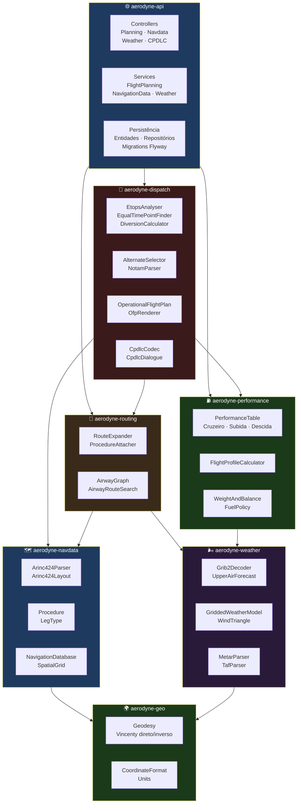
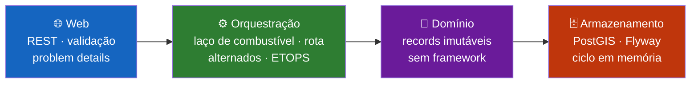
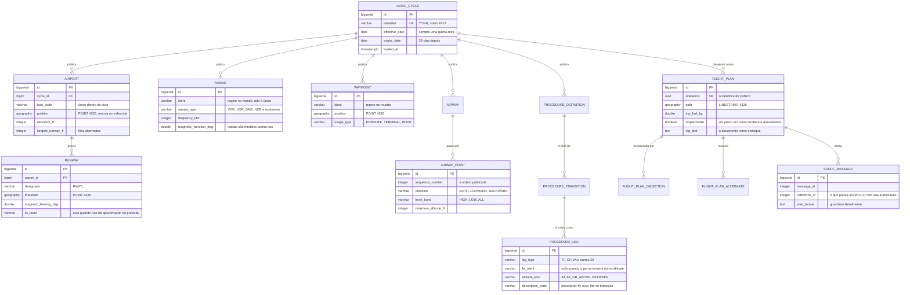
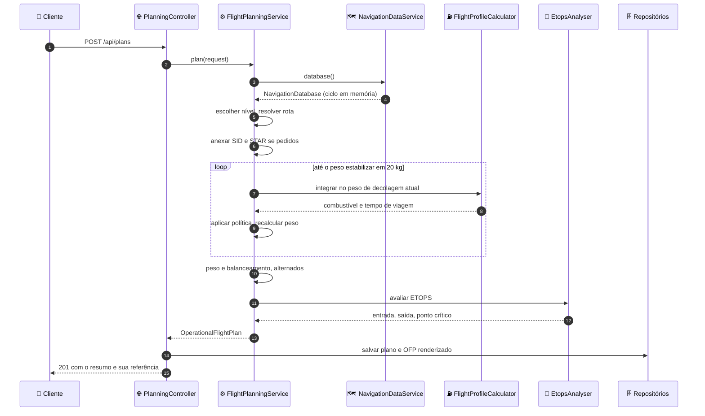
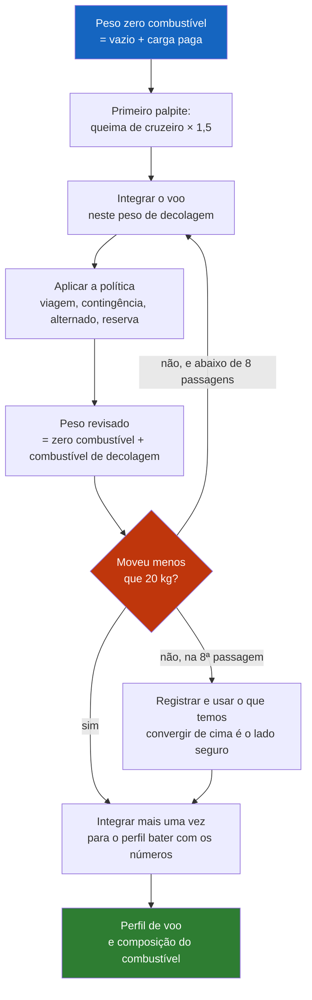
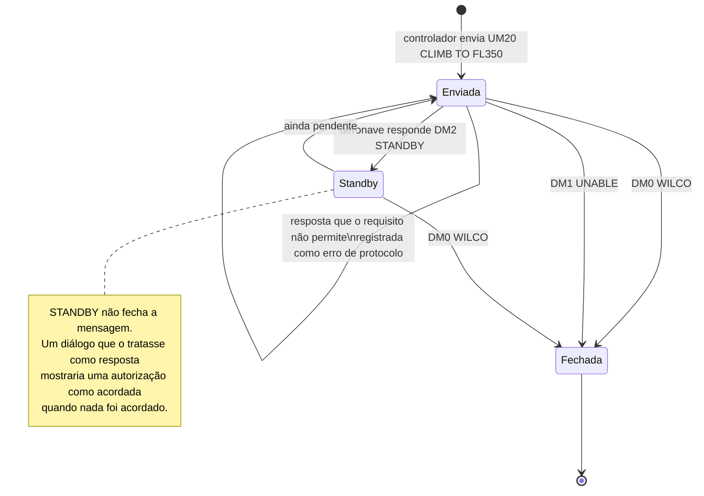
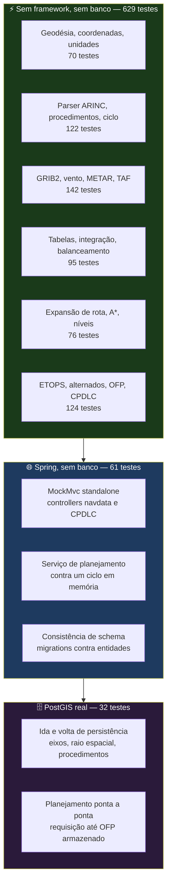

<div align="center">

**🌐 Choose Language / Selecione o Idioma / Elija el Idioma**

[](README.md)&nbsp;&nbsp;&nbsp;[](README_PT.md)&nbsp;&nbsp;&nbsp;[](README_ES.md)

</div>

---

<div align="center">

```
 █████╗ ███████╗██████╗  ██████╗ ██████╗ ██╗   ██╗███╗   ██╗███████╗
██╔══██╗██╔════╝██╔══██╗██╔═══██╗██╔══██╗╚██╗ ██╔╝████╗  ██║██╔════╝
███████║█████╗  ██████╔╝██║   ██║██║  ██║ ╚████╔╝ ██╔██╗ ██║█████╗
██╔══██║██╔══╝  ██╔══██╗██║   ██║██║  ██║  ╚██╔╝  ██║╚██╗██║██╔══╝
██║  ██║███████╗██║  ██║╚██████╔╝██████╔╝   ██║   ██║ ╚████║███████╗
╚═╝  ╚═╝╚══════╝╚═╝  ╚═╝ ╚═════╝ ╚═════╝    ╚═╝   ╚═╝  ╚═══╝╚══════╝
        Motor de planejamento de voo e despacho aeronáutico
```

---


<br/>

> **Um motor de planejamento de voo que calcula o que a aeronave vai realmente queimar, para onde ela pode desviar e se ela pode decolar.**
> Geodésia, dados de navegação, ventos em altitude, desempenho de aeronave e regras de despacho, cada um resolvido a partir dos princípios em vez de aproximado.

<br/>


</div>

---

## 📑 Índice

<details>
<summary>▶️ <strong>Clique para expandir / recolher esta seção</strong></summary>

<table>
<tr>
<td valign="top">

**🏗️ Sistema**

- [🌟 Visão Geral](#-visão-geral)
- [🏗️ Arquitetura do Sistema](#️-arquitetura-do-sistema)
- [🛠️ Stack Tecnológica](#️-stack-tecnológica)
- [📁 Estrutura do Projeto](#-estrutura-do-projeto)

**📦 Módulos**

- [📦 Módulos do Sistema](#-módulos-do-sistema)
- [🗄️ Modelo de Dados](#️-modelo-de-dados)
- [🔄 Fluxos do Sistema](#-fluxos-do-sistema)

</td>
<td valign="top">

**💼 Negócio**

- [💼 Regras de Negócio](#-regras-de-negócio)
- [✅ Requisitos Funcionais](#-requisitos-funcionais)
- [⚡ Requisitos Não Funcionais](#-requisitos-não-funcionais)

**📐 Design**

- [🎨 Padrões de Projeto Aplicados](#-padrões-de-projeto-aplicados)

**🔐 Segurança & Operação**

- [🔐 Segurança](#-segurança)
- [🚀 Instalação & Execução](#-instalação--execução)
- [🧪 Testes Automatizados](#-testes-automatizados)
- [📊 Métricas & Monitoramento](#-métricas--monitoramento)
- [⚠️ Limitações Conhecidas](#️-limitações-conhecidas)

</td>
</tr>
</table>

---

</details>

## 🌟 Visão Geral

<details>
<summary>▶️ <strong>Clique para expandir / recolher esta seção</strong></summary>

O Aerodyne responde às perguntas que um centro de operações de uma companhia aérea faz antes de um voo partir. Quanto combustível esta aeronave precisa para voar esta rota neste dia, contra estes ventos, com este peso? Para onde ela desvia se um motor falhar sobre o oceano? A previsão do destino é boa o bastante para voar sem manter um segundo aeródromo de reserva? Ela pode decolar?

Nenhuma dessas perguntas tem atalho. O número do combustível depende de um campo de vento que varia em três dimensões e no tempo, de um peso que cai conforme o combustível queima, e de tabelas lidas contra ambos. A pergunta do desvio depende de distâncias geodésicas medidas sobre um elipsoide e de tempos de voo que diferem das distâncias porque o vento sopra. A pergunta do despacho depende de regras que interagem: um peso de decolagem é limitado pela estrutura, pelo limite de peso zero combustível mais o combustível a bordo, e pelo limite de pouso mais o combustível que vai queimar, e o menor dos três vence.

O motor resolve cada um deles a partir dos princípios. A solução inversa de Vincenty em vez de uma aproximação esférica. Um decodificador GRIB2 em vez de uma constante de vento. Uma integração ao longo da rota em vez de distância dividida por velocidade. Tudo abaixo da camada web é Java puro, sem framework algum, e é testado sem um.

### 🎯 Objetivos do Sistema

| | Objetivo | Descrição |
|---|---|---|
| 🌍 | **Medir a Terra corretamente** | Distâncias e proas sobre o elipsoide WGS-84, ao metro, porque uma distância ETOPS publicada precisa ser reproduzível |
| 🗺️ | **Ler o banco de navegação** | Interpretar registros de coluna fixa ARINC 424 em aeroportos, pistas, auxílios-rádio, waypoints, aerovias e procedimentos terminais |
| 🌬️ | **Usar o vento real** | Decodificar previsões GRIB2 de altitude e interpolá-las no espaço, na altitude e no tempo |
| ⛽ | **Integrar o combustível** | Percorrer a rota perna a perna, acompanhando o peso cair conforme o combustível queima, contra o vento em cada ponto |
| ⚖️ | **Carregar a aeronave** | Peso e balanceamento com envelope de centro de gravidade certificado, verificado como polígono e não como par de limites |
| 🧭 | **Construir a rota** | Expandir uma rota apresentada contra o banco, ou buscar uma na malha de aerovias |
| 🛟 | **Planejar os desvios** | Pontos de entrada e saída ETOPS, pontos de tempo igual, e alternados filtrados por pista, meteorologia e NOTAM |
| 📄 | **Produzir o documento** | Um plano operacional de voo em largura fixa que a tripulação confere contra um FMS linha a linha |
| 🚫 | **Recusar quando deve** | Um plano que quebra um limite é calculado, armazenado e devolvido com as razões pelas quais não pode voar |
| 🔁 | **Permanecer reproduzível** | As mesmas entradas dão o mesmo plano em toda execução e em toda máquina |

---

</details>

## 🏗️ Arquitetura do Sistema

<details>
<summary>▶️ <strong>Clique para expandir / recolher esta seção</strong></summary>

O motor são sete módulos Maven em ordem estrita de dependência. Nada aponta para cima, e só o módulo do topo sabe que o Spring existe. É isso que permite testar a geodésia, os parsers e a integração de combustível em milissegundos, sem contêiner e sem banco.

### Diagrama de Módulos



### Camadas da Arquitetura



A camada de orquestração é fina de propósito. O `FlightPlanningService` não faz cálculo próprio; o que ele possui é a ordem em que os passos rodam, e uma coisa genuinamente difícil: o laço do combustível. O peso de decolagem determina a queima, e a queima determina o combustível a bordo, que é parte do peso de decolagem. Resolve-se iterando até um ponto fixo, convergindo a partir de uma superestimativa, de modo que interrompê-lo cedo erra para o lado seguro.

---

</details>

## 🛠️ Stack Tecnológica

<details>
<summary>▶️ <strong>Clique para expandir / recolher esta seção</strong></summary>

<table>
  <thead>
    <tr><th>Camada</th><th>Tecnologia</th><th>Versão</th><th>Finalidade</th></tr>
  </thead>
  <tbody>
    <tr>
      <td rowspan="2"><b>Linguagem e build</b></td>
      <td>Java</td><td>21</td><td>Records, switches selados, text blocks</td>
    </tr>
    <tr><td>Apache Maven</td><td>3.9</td><td>Build reator de sete módulos</td></tr>
    <tr>
      <td rowspan="4"><b>Web</b></td>
      <td>Spring Boot</td><td>3.3.4</td><td>Contêiner da aplicação e autoconfiguração</td>
    </tr>
    <tr><td>Spring Web MVC</td><td>6.1</td><td>Controllers REST, problem details RFC 7807</td></tr>
    <tr><td>Hibernate Validator</td><td>8.0</td><td>Validação de requisição nos records de DTO</td></tr>
    <tr><td>springdoc-openapi</td><td>2.6.0</td><td>Documento OpenAPI e Swagger UI</td></tr>
    <tr>
      <td rowspan="4"><b>Persistência</b></td>
      <td>PostgreSQL</td><td>16</td><td>Sistema de registro de ciclos e planos</td>
    </tr>
    <tr><td>PostGIS</td><td>3.4</td><td>Colunas geography, busca por raio em metros</td></tr>
    <tr><td>Hibernate Spatial</td><td>6.5.3.Final</td><td>Mapeamento de geometrias JTS para PostGIS</td></tr>
    <tr><td>Flyway</td><td>10.17.3</td><td>Migrations versionadas de schema</td></tr>
    <tr>
      <td rowspan="3"><b>Bibliotecas</b></td>
      <td>JTS Topology Suite</td><td>1.19.0</td><td>Tipos geométricos ponto e linestring</td>
    </tr>
    <tr><td>Jackson Databind</td><td>2.17.2</td><td>Payloads JSON e arquivos de tabela de desempenho</td></tr>
    <tr><td>SLF4J</td><td>2.0.16</td><td>Fachada de log em todos os módulos</td></tr>
    <tr>
      <td rowspan="3"><b>Testes</b></td>
      <td>JUnit Jupiter</td><td>5.11.0</td><td>Testes aninhados, parametrizados e condicionais</td>
    </tr>
    <tr><td>AssertJ</td><td>3.26.3</td><td>Asserções fluentes com contexto de falha nomeado</td></tr>
    <tr><td>Testcontainers</td><td>1.21.3</td><td>PostGIS descartável para testes de integração</td></tr>
    <tr>
      <td rowspan="3"><b>Formatos de dados</b></td>
      <td>ARINC 424-18</td><td>—</td><td>Registros do banco de navegação, 132 colunas fixas</td>
    </tr>
    <tr><td>WMO GRIB2</td><td>—</td><td>Grades de vento e temperatura em altitude</td></tr>
    <tr><td>ICAO METAR / TAF / NOTAM</td><td>—</td><td>Meteorologia e interdições de aeródromo</td></tr>
  </tbody>
</table>

> [!NOTE]
> Nenhuma biblioteca geoespacial é usada na matemática de navegação. As soluções de Vincenty, os auxiliares de círculo máximo e os parsers de coordenada são implementados diretamente, porque o contrato de precisão importa mais que a conveniência.

---

</details>

## 🎨 Padrões de Projeto Aplicados

<details>
<summary>▶️ <strong>Clique para expandir / recolher esta seção</strong></summary>

| Padrão | Onde | Justificativa |
|---|---|---|
| **Objeto de valor imutável** | `GeoPoint`, `WindVector`, `ProcedureLeg`, todos os records de domínio | Nada num plano calculado pode mudar sob um chamador. Records dão igualdade, construtor que valida e segurança entre threads sem esforço |
| **Strategy** | `WeatherModel` com `ConstantWeatherModel` e `GriddedWeatherModel` | A integração pede o vento num ponto e não se importa se há previsão carregada. Cair para a atmosfera padrão é uma resposta real, não uma falha |
| **Builder** | `NavigationDatabase.Builder`, `GriddedWeatherModel.Builder`, `WeightAndBalance` | Estes agregam várias coleções e precisam ser imutáveis depois de prontos. O builder é o que torna as duas coisas possíveis |
| **Parsing por tabela** | `Arinc424Layout` | Todo offset de coluna vive num arquivo só. Uma variante de fornecedor se corrige editando uma constante, não caçando pelo código de parsing |
| **Separação de dois modelos** | `NavigationEntities` contra os records de domínio | Registros de armazenamento são mutáveis e têm identidade. Records de domínio são imutáveis e têm comportamento. Mantê-los separados custa um mapeamento e compra um domínio que um teste constrói numa linha |
| **Preditor-corretor** | `FlightProfileCalculator.cruiseLeg` | O consumo depende do peso e o peso cai conforme o combustível queima. Queimar a perna duas vezes, a segunda no peso médio, remove a maior parte do viés |
| **Busca por bisseção** | `EqualTimePointFinder` | O campo de vento não é suave, então um método que assumisse suavidade poderia sair de uma borda de corrente de jato. A bisseção converge de forma confiável numa função contínua |
| **A\* com heurística admissível** | `AirwayRouteSearch` | A distância de círculo máximo nunca superestima a rota restante, e é isso que torna a primeira rota completada comprovadamente a mais curta |
| **Objeto nulo** | `CpdlcArchive.NONE` | Um teste de protocolo não pode precisar de banco. O arquivo no-op é o que permite testar o diálogo sozinho |
| **Marcação de procedência** | `DataProvenance` em `AircraftType` | Um plano com números inventados é idêntico a um plano com manual de voo. Levar a procedência junto com o dado é o que permite à decisão de despacho ver a diferença |

---

</details>

## 📁 Estrutura do Projeto

<details>
<summary>▶️ <strong>Clique para expandir / recolher esta seção</strong></summary>

```
📂 aerodyne/
├── 📄 pom.xml                                  # Build reator, sete módulos, gestão de dependências
│
├── 📂 aerodyne-geo/                            # Geodésia de navegação, sem dependências além do SLF4J
│   └── 📂 src/main/java/io/aerodyne/geo/
│       ├── 📄 Geodesy.java                     # Vincenty direto e inverso, círculo máximo, loxodromia, cross-track
│       ├── 📄 GeoPoint.java                    # Uma posição, longitude normalizada na construção
│       ├── 📄 Ellipsoid.java                   # WGS-84 e as constantes que Vincenty precisa
│       ├── 📄 GeodesicSolution.java            # Distância, proa inicial e final, iterações usadas
│       ├── 📄 CoordinateFormat.java            # Seis notações lidas, quatro escritas
│       └── 📄 Units.java                       # Milhas náuticas, pés, nós, temperatura ISA e Mach
│
├── 📂 aerodyne-navdata/                        # O banco de navegação
│   ├── 📂 src/main/java/io/aerodyne/navdata/
│   │   ├── 📄 NavigationDatabase.java          # Ciclo indexado, resolução posicional de identificador
│   │   ├── 📄 SpatialGrid.java                 # Células de um grau para "o que está perto daqui"
│   │   ├── 📄 GridMora.java                    # Uma faixa de altitudes mínimas fora de rota
│   │   ├── 📄 MinimumAltitudeGrid.java         # A grade toda, e a varredura ao longo da rota
│   │   ├── 📄 AiracCycle.java                  # Ciclos de 28 dias a partir da época de 2001
│   │   ├── 📄 Airport.java 📄 Runway.java       # Aeródromos e direções de pouso
│   │   ├── 📄 Navaid.java 📄 Waypoint.java      # Auxílios-rádio e posições nomeadas
│   │   ├── 📄 Airway.java 📄 AirwayPoint.java   # Aerovias de rota e suas pernas
│   │   ├── 📂 arinc/                           # O parser de coluna fixa
│   │   │   ├── 📄 Arinc424Parser.java          # Despacho de registro, acumulação, montagem
│   │   │   ├── 📄 Arinc424Layout.java          # Todo offset de coluna, num arquivo só
│   │   │   └── 📄 Arinc424Diagnostic.java      # Detecta um layout que não serve ao arquivo
│   │   └── 📂 procedure/                       # SID, STAR e aproximação
│   │       ├── 📄 LegType.java                 # 23 códigos de trajetória e terminador
│   │       ├── 📄 Procedure.java               # Segmentos unidos nas pernas voadas
│   │       └── 📄 AltitudeConstraint.java      # Em, acima, abaixo, e a janela lida corretamente
│   └── 📂 src/test/resources/arinc/
│       ├── 📄 generate_fixture.py              # Gera o extrato a partir do mapa de colunas
│       └── 📄 extract.arinc                    # 41 registros cobrindo cada tipo suportado
│
├── 📂 aerodyne-weather/                        # Vento, temperatura e meteorologia de aeródromo
│   └── 📂 src/main/java/io/aerodyne/weather/
│       ├── 📄 GriddedWeatherModel.java         # Interpolação no espaço, altitude e tempo
│       ├── 📄 LatLonGrid.java                  # Amostragem bilinear com volta no antimeridiano
│       ├── 📄 WindTriangle.java                # Proa e velocidade no solo, resolvidas por vetores
│       ├── 📄 StandardAtmosphere.java          # Superfície isobárica para altitude-pressão
│       ├── 📂 grib/                            # GRIB2
│       │   ├── 📄 Grib2Decoder.java            # Seções 0 a 8, templates 3.0, 4.0 e 5.0
│       │   └── 📄 UpperAirForecast.java        # Pareia as componentes de vento, empilha os níveis
│       └── 📂 metar/                           # Boletins de aeródromo
│           ├── 📄 MetarParser.java             # Todo grupo de uma observação
│           └── 📄 TafParser.java               # Prevalecente contra o pior caso
│
├── 📂 aerodyne-performance/                    # Desempenho de aeronave e combustível
│   └── 📂 src/main/java/io/aerodyne/performance/
│       ├── 📄 FlightProfileCalculator.java     # A integração, perna a perna
│       ├── 📄 PerformanceTable.java            # Bilinear, limitada em vez de extrapolada
│       ├── 📄 WeightAndBalance.java            # Momentos sobre o datum, envelope verificado
│       ├── 📄 FuelPolicy.java                  # Táxi, viagem, contingência, alternado, reserva
│       ├── 📄 StepClimbPolicy.java             # Quando o cruzeiro pode subir, e de quanto
│       ├── 📄 AircraftTypeLoader.java          # Lê as tabelas do próprio operador em JSON
│       └── 📄 AircraftTypes.java               # Dois exemplos trabalhados, marcados como tal
│
├── 📂 aerodyne-routing/                        # Construção de rota
│   └── 📂 src/main/java/io/aerodyne/routing/
│       ├── 📄 RouteExpander.java               # Uma rota apresentada resolvida contra o banco
│       ├── 📄 ProcedureAttacher.java           # Une a SID e a STAR à rota de cruzeiro
│       ├── 📄 AirwayGraph.java                 # A malha como ela existe num nível
│       ├── 📄 AirwayRouteSearch.java           # A* com heurística admissível
│       ├── 📄 WindOptimalRouteSearch.java      # A mesma busca, custeada em tempo e não distância
│       └── 📄 SemicircularRule.java            # Quais níveis uma derrota pode usar
│
├── 📂 aerodyne-dispatch/                       # A decisão de despacho
│   └── 📂 src/main/java/io/aerodyne/dispatch/
│       ├── 📄 EtopsAnalyser.java               # Entrada, saída e o ponto crítico
│       ├── 📄 EtopsAerodromeScreen.java        # Adequado contra apropriado, e qual dos dois fez
│       ├── 📄 EqualTimePointFinder.java        # Bisseção na diferença de tempo de voo
│       ├── 📄 AlternateSelector.java           # Pista, aproximação, previsão e NOTAM
│       ├── 📂 notam/ 📄 NotamParser.java        # Linha Q decodificada, linha E preservada
│       ├── 📂 ofp/ 📄 OfpRenderer.java          # O documento de largura fixa
│       └── 📂 cpdlc/ 📄 CpdlcCodec.java         # Elementos de mensagem e o pareamento por referência
│
├── 📂 aerodyne-api/                            # Aplicação Spring Boot
│   ├── 📂 src/main/java/io/aerodyne/api/
│   │   ├── 📄 AerodyneApplication.java         # A única classe que conhece o Spring primeiro
│   │   ├── 📂 web/                             # Quatro controllers, um tratador de exceções
│   │   ├── 📂 service/                         # Orquestração, cache de navdata, store de meteorologia
│   │   ├── 📂 persistence/                     # Entidades, repositórios, conversão JTS
│   │   └── 📂 dto/                             # Records de requisição e resposta
│   └── 📂 src/main/resources/
│       ├── 📄 application.yml                  # Datasource, Flyway, JPA somente validação
│       └── 📂 db/migration/                    # V1 dados de navegação, V2 planos, V3 procedimentos
│
├── 📄 README.md                                # 🇺🇸 English
├── 📄 README_PT.md                             # 🇧🇷 Português (este arquivo)
└── 📄 README_ES.md                             # 🇪🇸 Español
```

---

</details>

## 📦 Módulos do Sistema

<details>
<summary>▶️ <strong>Clique para expandir / recolher esta seção</strong></summary>

### 🌍 aerodyne-geo

Geodésia de navegação sobre o elipsoide WGS-84, sem biblioteca geoespacial externa. Duas famílias de cálculo vivem aqui e respondem perguntas diferentes. As soluções elipsoidais têm precisão bem abaixo do metro e são usadas onde uma distância publicada precisa ser reproduzida. Os auxiliares esféricos são de forma fechada e baratos, e são o que a busca de rota chama no seu laço interno.

| Responsabilidade | API | Observações |
|---|---|---|
| Distância e proas elipsoidais | `Geodesy.inverse(from, to)` | Lança `ArithmeticException` num par quase antipodal em vez de devolver resposta errada |
| Posição a partir de proa e distância | `Geodesy.direct(from, bearing, metres)` | Inverte a solução inversa com erro abaixo de 1e-8 grau |
| Círculo máximo e loxodromia | `greatCircleDistanceNm`, `rhumbDistanceNm` | Dentro de 0,3 % do elipsoide, o que a heurística da busca tolera |
| Manutenção de derrota | `crossTrackDistanceNm`, `alongTrackDistanceNm` | Com sinal, positivo à direita da derrota |
| Notações de coordenada | `CoordinateFormat.parseOrNull` | ARINC empacotada, graus e minutos decimais, GMS, ICAO, abreviação oceânica, decimal com sinal |
| Conversão de unidades | `Units` | Milha náutica e pé exatos por definição; temperatura ISA e Mach para velocidade verdadeira |

---

### 🗺️ aerodyne-navdata

Um leitor ARINC 424 e um banco indexado para um ciclo AIRAC. O formato é de coluna fixa, 132 caracteres por registro, e o parser é deliberadamente tolerante: um arquivo de navdata são dezenas de megabytes de texto de terceiros e um punhado de registros ilegíveis é rotina. O que ele não faz é adivinhar, então um registro sem posição legível é descartado em vez de colocado no equador.

| Responsabilidade | API | Observações |
|---|---|---|
| Ler um ciclo | `Arinc424Parser.parse(path)` | Aeroportos, pistas, auxílios VHF e NDB, waypoints, aerovias, SID, STAR e aproximação |
| Detectar layout incompatível | `Arinc424Diagnostic.check(file)` | Taxa de falha acima de 25 % num tipo de registro significa que o mapa de colunas não serve |
| Resolver um identificador | `NavigationDatabase.resolve(ident, near)` | Identificadores se repetem no mundo, então o candidato mais próximo da rota vence |
| Achar o que está perto | `fixesWithin`, `airportsWithin` | Grade de células de um grau, filtrada por distância verdadeira |
| Ler um procedimento | `procedures(icao, type)` | Segmentos guardados separados, unidos por `Procedure.assemble` |
| Acompanhar o ciclo | `AiracCycle.effectiveOn(date)` | Ciclos de 28 dias, todos começando numa quinta-feira |
| Livrar o terreno | `minimumAltitudes().along(path, interval)` | MORA de grade ao longo da rota; um quadrado não levantado responde desconhecido, nunca zero |

---

### 🌬️ aerodyne-weather

Um decodificador GRIB2, um modelo de vento interpolador, o triângulo do vento, e parsers de METAR, TAF e da atmosfera padrão. GRIB2 é um formato contêiner e o decodificador lê o subconjunto em que os ventos de altitude são publicados: grade regular de latitude e longitude, previsão instantânea e empacotamento simples. Qualquer outra coisa é recusada pelo nome em vez de mal lida, porque um campo de vento decodificado com o desempacotamento errado parece plausível e está errado.

| Responsabilidade | API | Observações |
|---|---|---|
| Decodificar uma previsão | `Grib2Decoder.decode(bytes)` | Seções 0 a 8, inteiros sinal-magnitude, desempacotamento de n bits |
| Montar um modelo | `UpperAirForecast.assemble` | Pareia `UGRD` com `VGRD`, converte para nós e Celsius uma vez |
| Amostrar o vento | `GriddedWeatherModel.at(point, altitude, time)` | Bilinear na horizontal, em altitude-pressão na vertical, linear no tempo |
| Resolver o triângulo | `WindTriangle.solve(course, tas, wind)` | Solução vetorial; lança quando o vento de través excede a velocidade aerodinâmica |
| Ler uma observação | `MetarParser.parse(text)` | Vento, visibilidade em metros ou milhas terrestres, nuvem, RVR, tempo presente, pressão |
| Ler uma previsão | `TafParser.parse(text)` | `prevailingAt` e `worstCaseAt`, que diferem e ambos importam |

---

### ⛽ aerodyne-performance

Tabelas de aeronave, a integração de combustível e tempo, peso e balanceamento, e a política de combustível. A integração é onde o motor justifica o nome: percorre a rota em passos não maiores que 100 milhas náuticas, amostra o vento no meio de cada passo no instante em que a aeronave está lá, e acompanha o peso cair conforme o combustível queima.

| Responsabilidade | API | Observações |
|---|---|---|
| Ler uma tabela | `PerformanceTable.valueAt(weight, altitude)` | Bilinear, limitada nas bordas em vez de extrapolada |
| Integrar um voo | `FlightProfileCalculator.compute(request)` | Subida, cruzeiro e descida, com preditor-corretor em cada perna de cruzeiro |
| Subir conforme alivia | `StepClimbPolicy.standard()` | Um degrau só é tomado quando seu combustível mais o cruzeiro acima custa menos que o cruzeiro abaixo |
| Carregar a aeronave | `WeightAndBalance.forType(type)` | Momentos sobre o datum, centro de gravidade como percentual da corda |
| Verificar o envelope | `CentreOfGravityEnvelope.contains` | Lançamento de raio, porque o envelope é um polígono e não um retângulo |
| Aplicar a política de combustível | `FuelPolicy.apply(trip, alternate, additional, extra)` | Contingência com piso de espera, reserva final que não pode ser planejada |
| Carregar tabelas do operador | `AircraftTypeLoader.load(path)` | JSON no formato das tabelas publicadas, validado estritamente |

---

### 🧭 aerodyne-routing

Expansão de rota, anexação de procedimento e busca em aerovias. Uma rota apresentada é concisa e a maior parte do que ela diz é implícita: `EGLL DCT KOLIN UN862 BEDEK DCT LEBL` nomeia cinco coisas e descreve um caminho por quantos fixos `UN862` cruzar.

| Responsabilidade | API | Observações |
|---|---|---|
| Expandir uma rota apresentada | `RouteExpander.expand(route, from)` | Percorre aerovias, pula grupos de velocidade e nível, resolve posicionalmente |
| Anexar os procedimentos | `ProcedureAttacher.attach(...)` | Verifica a junção, descarta pernas sem posição, relata as duas coisas |
| Construir a malha | `AirwayGraph.build(database, altitude)` | Altitude embutida, então o que for encontrado é por construção apresentável |
| Buscar nela por distância | `AirwayRouteSearch.search(from, to)` | A\* com heurística de círculo máximo; a primeira rota completada é a mais curta |
| Buscar nela por tempo | `WindOptimalRouteSearch.search(from, to)` | O mesmo A\*, custeado em minutos contra a previsão, com uma heurística que continua admissível |
| Escolher um nível | `SemicircularRule.nearestAvailableLevel` | Ímpar para leste, par para oeste, 4000 pés de espaçamento acima do FL410 |

---

### 🛟 aerodyne-dispatch

ETOPS, pontos de tempo igual, seleção de alternados, parsing de NOTAM, o documento OFP e o codec de datalink. A distinção que este módulo guarda com cuidado é entre distância e tempo. Um ponto de tempo igual não é um ponto de distância igual, e com 100 nós de vento na derrota os dois ficam bem longe um do outro.

| Responsabilidade | API | Observações |
|---|---|---|
| Cronometrar um desvio | `DiversionCalculator.to(from, aerodrome, at)` | Vento amostrado no meio da perna, no nível com motor inoperante |
| Achar um ponto de tempo igual | `EqualTimePointFinder.between(...)` | Bisseção até meio minuto; informa quando a rota não tem cruzamento |
| Avaliar ETOPS | `EtopsAnalyser.analyse(...)` | Entrada, saída, ponto crítico, e a aprovação que a rota exigiria |
| Filtrar alternados | `AlternateSelector.screen(...)` | Candidatos recusados guardados com suas razões, que é o que um despachante precisa |
| Filtrar alternados de rota | `EtopsAerodromeScreen.along(...)` | Adequado contra apropriado, e ele diz qual dos dois conseguiu fazer |
| Decodificar um NOTAM | `NotamParser.parse(text)` | Linha Q decodificada em assunto e condição; linha E preservada literalmente |
| Renderizar o OFP | `OfpRenderer.render(plan)` | Monoespaçado alinhado por colunas, quebrado e nunca truncado |
| Trocar datalink | `CpdlcCodec`, `CpdlcDialogue` | Pareamento por referência, e `STANDBY` corretamente deixando a autorização aberta |

---

### 🌐 aerodyne-api

A aplicação Spring Boot. Ela não guarda lógica de planejamento. O que ela possui é a persistência em PostGIS, a superfície REST e a orquestração que põe os módulos em ordem.

| Endpoint | Método | Finalidade |
|---|---|---|
| `/api/plans` | POST | Calcular um plano e armazená-lo |
| `/api/plans/{reference}` | GET | O resumo armazenado |
| `/api/plans/{reference}/ofp` | GET | O documento renderizado, servido literalmente do armazenamento |
| `/api/navdata/cycle` | GET | Qual ciclo AIRAC está carregado e quanto há nele |
| `/api/navdata/fixes/{ident}` | GET | Tudo publicado sob um identificador |
| `/api/navdata/fixes` | GET | O que está perto de uma posição, mais próximo primeiro |
| `/api/navdata/airports/{icao}` | GET | Um aeródromo e suas pistas |
| `/api/navdata/airports/{icao}/procedures` | GET | SID, STAR e aproximações, pernas como voadas |
| `/api/navdata/route` | GET | Expandir uma rota sem planejar sobre ela |
| `/api/weather` | GET | Que meteorologia o motor guarda |
| `/api/weather/metar` · `/taf` · `/notam` | POST | Submeter um boletim como o texto em que ele chega |
| `/api/weather/upper-air` | POST | Enviar um arquivo GRIB2 |
| `/api/weather/upper-air/from-path` | POST | Carregar um de um caminho no servidor |
| `/api/cpdlc/{aircraft}/messages` | POST | Enviar uma autorização ou um pedido |
| `/api/cpdlc/{aircraft}/outstanding` | GET | O que aguarda resposta |

---

</details>

## 💼 Regras de Negócio

<details>
<summary>▶️ <strong>Clique para expandir / recolher esta seção</strong></summary>

### Combustível e peso

| # | Regra | Onde é aplicada |
|---|---|---|
| RN-01 | O peso de decolagem é o menor entre o limite estrutural, o limite de peso zero combustível mais o combustível a bordo, e o limite de pouso mais o combustível de viagem | `WeightLimits.maximumTakeoffWeightKg` |
| RN-02 | O combustível de contingência é um percentual do de viagem, com piso expresso em minutos de espera | `FuelPolicy.apply` |
| RN-03 | A reserva final nunca pode ser planejada | `FuelBreakdown.protectsFinalReserve` |
| RN-04 | Combustível de rampa acima da capacidade dos tanques recusa o despacho | `OperationalFlightPlan.dispatchObjections` |
| RN-05 | Centro de gravidade fora do envelope recusa o despacho, em qualquer dos três pesos | `WeightAndBalance.checkCg` |
| RN-06 | Um plano construído sobre dados representativos e não de fabricante não pode ser despachado | `DataProvenance.isDispatchable` |

### Rota e espaço aéreo

| # | Regra | Onde é aplicada |
|---|---|---|
| RN-07 | Uma perna de aerovia só é utilizável dentro da sua faixa de nível e dos limites de altitude publicados | `AirwayPoint.permitsAltitude` |
| RN-08 | Uma aerovia de mão única não pode ser voada contra o seu sentido | `Airway.between` |
| RN-09 | Derrotas magnéticas para leste voam níveis ímpares, para oeste pares, com espaçamento de 4000 pés acima do FL410 | `SemicircularRule.isAvailable` |
| RN-10 | Um identificador repetido resolve para o candidato mais próximo da rota, e é recusado quando não há contra o que resolver | `NavigationDatabase.resolve` |
| RN-11 | Um procedimento só é anexado se ele se junta à rota onde a rota começa ou termina | `ProcedureAttacher.select` |
| RN-12 | Um nível de cruzeiro abaixo da maior altitude mínima fora de rota levantada na rota recusa o despacho | `OperationalFlightPlan.dispatchObjections` |

### Despacho

| # | Regra | Onde é aplicada |
|---|---|---|
| RN-12 | Um alternado é mantido contra o pior caso da sua previsão, não contra as condições prevalecentes | `AlternateSelector.worstCaseAt` |
| RN-13 | Um aeródromo sem previsão cobrindo a chegada não qualifica como alternado | `AlternateCriteria.requireCurrentWeather` |
| RN-14 | Um aeródromo interditado por NOTAM ativo no horário de chegada não qualifica | `AlternateSelector.assess` |
| RN-15 | Uma rota bimotor além do tempo de desvio aprovado recusa o despacho | `EtopsAnalysis.isCompliant` |
| RN-16 | Um plano cuja previsão de vento não cobre toda a rota recusa o despacho | `FlightProfile.usedForecastWind` |
| RN-17 | Um plano recusado ainda é calculado e armazenado, com as suas razões | `PlanningController.plan` |
| RN-18 | Uma rota ETOPS cujos alternados de rota nunca foram filtrados contra uma previsão recusa o despacho | `EtopsAnalysis.weatherScreened` |

---

</details>

## ✅ Requisitos Funcionais

<details>
<summary>▶️ <strong>Clique para expandir / recolher esta seção</strong></summary>

| ID | Requisito | Prioridade | Status |
|---|---|---|---|
| RF-01 | Calcular distância geodésica e proas em WGS-84 | 🔴 Alta | ✅ Implementado |
| RF-02 | Ler e escrever as notações de coordenada usadas em dados de navegação e rotas apresentadas | 🔴 Alta | ✅ Implementado |
| RF-03 | Ler um arquivo ARINC 424 em aeroportos, pistas, auxílios, waypoints e aerovias | 🔴 Alta | ✅ Implementado |
| RF-04 | Ler procedimentos SID, STAR e aproximação com suas pernas de trajetória e terminador | 🔴 Alta | ✅ Implementado |
| RF-05 | Detectar e recusar um arquivo ARINC ao qual o mapa de colunas não serve | 🟡 Média | ✅ Implementado |
| RF-06 | Resolver um ciclo AIRAC a partir de uma data e acompanhar sua validade | 🟡 Média | ✅ Implementado |
| RF-07 | Decodificar grades GRIB2 de vento e temperatura em altitude | 🔴 Alta | ✅ Implementado |
| RF-08 | Interpolar vento em latitude, longitude, altitude e tempo | 🔴 Alta | ✅ Implementado |
| RF-09 | Interpretar observações METAR e SPECI | 🔴 Alta | ✅ Implementado |
| RF-10 | Interpretar previsões TAF, distinguindo prevalecente de pior caso | 🔴 Alta | ✅ Implementado |
| RF-11 | Interpretar NOTAMs e decodificar a linha Q | 🟡 Média | ✅ Implementado |
| RF-12 | Integrar combustível e tempo ao longo de uma rota contra o vento previsto | 🔴 Alta | ✅ Implementado |
| RF-13 | Calcular peso e balanceamento contra um envelope certificado | 🔴 Alta | ✅ Implementado |
| RF-14 | Aplicar uma política regulatória de combustível | 🔴 Alta | ✅ Implementado |
| RF-15 | Carregar as tabelas de desempenho do próprio operador de um arquivo | 🟡 Média | ✅ Implementado |
| RF-16 | Expandir uma rota apresentada contra o banco de navegação | 🔴 Alta | ✅ Implementado |
| RF-17 | Buscar na malha de aerovias uma rota mais curta | 🟡 Média | ✅ Implementado |
| RF-18 | Anexar procedimentos de saída e chegada a uma rota | 🟡 Média | ✅ Implementado |
| RF-19 | Selecionar um nível de cruzeiro pela regra semicircular | 🟡 Média | ✅ Implementado |
| RF-20 | Calcular pontos de entrada, saída e crítico do ETOPS | 🔴 Alta | ✅ Implementado |
| RF-21 | Calcular pontos de tempo igual entre aeródromos adequados | 🔴 Alta | ✅ Implementado |
| RF-22 | Filtrar alternados por pista, aproximação, previsão e NOTAMs | 🔴 Alta | ✅ Implementado |
| RF-23 | Renderizar um plano operacional de voo em largura fixa | 🔴 Alta | ✅ Implementado |
| RF-24 | Codificar, decodificar e acompanhar uma troca de datalink controlador-piloto | 🟢 Baixa | ✅ Implementado |
| RF-25 | Persistir ciclos, planos, procedimentos e mensagens de datalink em PostGIS | 🟡 Média | ✅ Implementado |
| RF-26 | Otimizar uma rota por vento em vez de por distância | 🟡 Média | ✅ Implementado |
| RF-27 | Calcular um perfil de subida em degraus conforme o peso cai | 🟡 Média | ✅ Implementado |
| RF-28 | Decodificar altitudes mínimas de grade fora de rota e conferir a rota contra elas | 🟡 Média | ✅ Implementado |
| RF-29 | Filtrar alternados ETOPS de rota pela previsão, não só pelo comprimento de pista | 🔴 Alta | ✅ Implementado |
| RF-30 | Aceitar uma previsão de altitude por upload em vez de por caminho no servidor | 🟡 Média | ✅ Implementado |

---

</details>

## ⚡ Requisitos Não Funcionais

<details>
<summary>▶️ <strong>Clique para expandir / recolher esta seção</strong></summary>

| ID | Categoria | Requisito | Meta |
|---|---|---|---|
| RNF-01 | ⚡ Desempenho | Busca de rota na malha de aerovias | Abaixo de 200 000 nós expandidos, limitado por `nodeLimit` |
| RNF-02 | ⚡ Desempenho | Vento amostrado com frequência suficiente para cruzar uma corrente de jato | Nenhum passo de integração maior que 100 NM |
| RNF-03 | ⚡ Desempenho | Convergência do laço de combustível | Estabiliza em 20 kg, limitado a 8 passagens |
| RNF-04 | ⚡ Desempenho | Dados de navegação servidos da memória, não do banco | Um ciclo mantido, trocado atomicamente |
| RNF-05 | 🎯 Precisão | Distância elipsoidal | Abaixo do metro contra valores Vincenty publicados |
| RNF-06 | 🎯 Precisão | Aproximação esférica usada na busca | Dentro de 0,3 % do elipsoide |
| RNF-07 | 🔁 Reprodutibilidade | As mesmas entradas dão o mesmo plano | Mapas com ordem de inserção; nenhum `Map.copyOf` onde a ordem é lida |
| RNF-08 | 🔁 Reprodutibilidade | Um plano pode ser recalculado contra os dados que usou | Todo ciclo retido, referenciado pelo plano armazenado |
| RNF-09 | 🔐 Segurança operacional | Entrada indecodificável é recusada, nunca adivinhada | Empacotamento GRIB2, layout ARINC, enquadramento CPDLC |
| RNF-10 | 🔐 Segurança operacional | Meteorologia não informada não satisfaz um mínimo | `SurfaceConditions.meets` |
| RNF-11 | 🧵 Concorrência | O banco de navegação e o modelo de vento são seguros para compartilhar | Imutáveis, troca atômica de referência |
| RNF-12 | 🧪 Testabilidade | O motor é testável sem framework | 629 dos 722 testes não precisam de contexto Spring |
| RNF-13 | 🧪 Testabilidade | O build fica verde sem Docker | Testes de integração pulam limpo |
| RNF-14 | 📦 Portabilidade | Roda em qualquer JVM 21 ou superior | Sem código nativo ou específico de plataforma |
| RNF-15 | 🗄️ Integridade de dados | O schema é versionado e validado, nunca gerado | Migrations Flyway, `ddl-auto=validate` |
| RNF-16 | 📖 Observabilidade | Todo plano registra os dados sobre os quais foi construído | Ciclo AIRAC e fonte de vento no OFP |

---

</details>

## 🗄️ Modelo de Dados

<details>
<summary>▶️ <strong>Clique para expandir / recolher esta seção</strong></summary>

Onze tabelas em três migrations. Todo ciclo AIRAC é mantido em vez de sobrescrito, porque um plano precisa ser reproduzível contra os dados sobre os quais foi construído e um plano apresentado semana passada não pode ser conferido contra o ciclo desta semana.

### Diagrama Entidade-Relacionamento



### Convenções de tipo de coluna

| Convenção | Razão |
|---|---|
| `VARCHAR(n)`, nunca `CHAR(n)` | O PostgreSQL preenche um `CHAR` com espaços, então um valor lido de volta não é igual ao valor escrito |
| `GEOGRAPHY`, nunca `GEOMETRY` | Geography mede em metros no esferoide. Geometry mediria em graus e erraria pelo cosseno da latitude |
| `DOUBLE PRECISION`, nunca `NUMERIC` | O domínio trabalha em doubles porque estas são grandezas físicas e não dinheiro |
| Ciclo na chave de toda tabela de navegação | Um plano precisa ser reproduzível contra o ciclo que usou |

### Estruturas em memória

| Estrutura | Onde vive | Por que não no banco |
|---|---|---|
| `NavigationDatabase` | Um ciclo, mantido por `NavigationDataService` | Uma busca de rota pergunta "o que está perto daqui" a cada nó expandido; servido do banco seriam dezenas de milhares de idas e voltas por plano |
| `GriddedWeatherModel` | Carregado de um arquivo GRIB2 | Uma previsão expira em horas e não tem estrutura relacional que valha modelar |
| Store de METAR, TAF e NOTAM | `WeatherService` | Escrever uma linha por minuto por aeródromo para responder sobre as próximas duas horas é o formato errado |
| `CpdlcDialogue` | Um por aeronave conectada | O que está pendente só faz sentido enquanto a aeronave está conectada. O que foi dito é arquivado |

---

</details>

## 🔄 Fluxos do Sistema

<details>
<summary>▶️ <strong>Clique para expandir / recolher esta seção</strong></summary>

### Planejar um voo



### O laço do combustível



### Importar um ciclo de navegação

```mermaid
sequenceDiagram
    autonumber
    participant O as 👤 Operador
    participant S as ⚙️ NavigationDataService
    participant P as 🗺️ Arinc424Parser
    participant G as 🔍 Arinc424Diagnostic
    participant R as 🗄️ PostGIS

    O->>S: importArinc(file)
    S->>P: parse
    P-->>S: objetos, problemas, e o ciclo carimbado nos registros
    S->>G: verificar o layout
    alt taxa de falha acima de 25 % num tipo de registro
        G-->>S: provável incompatibilidade de layout
        S-->>O: 400, nomeando os tipos suspeitos
    else o mapa de colunas serve
        G-->>S: ok
        S->>R: salvar ciclo, aeroportos, auxílios, waypoints, aerovias, procedimentos
        Note over S,R: uma transação; um ciclo pela metade seria pior que nenhum
        S->>S: carregar em memória, trocar a referência atomicamente
        S-->>O: o que foi lido e o que foi descartado
    end
```

### Uma autorização por datalink



---

</details>

## 🔐 Segurança

<details>
<summary>▶️ <strong>Clique para expandir / recolher esta seção</strong></summary>

### Controles Implementados

| Controle | Implementação | Efeito |
|---|---|---|
| **Validação de entrada em toda requisição** | Jakarta Bean Validation nos records de DTO, padrões para códigos ICAO, pistas e identificadores de procedimento | Identificadores malformados são recusados antes de chegar ao motor |
| **Somente consultas parametrizadas** | Consultas derivadas do Spring Data e parâmetros nomeados nas consultas espaciais nativas | Nenhuma concatenação de string chega ao banco |
| **Schema validado, nunca gerado** | `ddl-auto=validate` com o Flyway dono das migrations | O ORM não pode alterar em silêncio um schema revisado |
| **Detalhe de erro omitido do cliente** | `server.error.include-message=never`, problem details RFC 7807 com texto curado | Rastros de pilha e caminhos internos ficam no log |
| **Recusa em vez de interpretação** | Empacotamento GRIB2 não suportado, incompatibilidade de layout ARINC, erros de enquadramento CPDLC | Dado de terceiro malformado não vira uma resposta errada plausível |
| **Procedência levada com os dados de desempenho** | `DataProvenance` em `AircraftType` | Um plano com números não verificados não pode ser despachado por acidente |
| **Objetos de domínio imutáveis** | Records em todo lugar, cópias defensivas de toda coleção | Um plano calculado não pode ser alterado depois da decisão |
| **Superfície do Actuator limitada** | Somente `health`, `info` e `metrics` expostos | Sem despejo de ambiente ou configuração na porta padrão |

### Limitações Conhecidas de Segurança

> [!WARNING]
> Não há autenticação, autorização nem segurança de transporte neste repositório. Ele é um motor, não um serviço implantado, e não deve ser exposto a uma rede sem que a camada abaixo seja adicionada antes.

| Limitação | Risco | Caminho de mitigação |
|---|---|---|
| Sem autenticação em nenhum endpoint | Qualquer um alcançável pode planejar, importar dados e enviar mensagens de datalink | Spring Security com resource server OAuth2, papéis para despacho e para importação de navdata |
| Sem modelo de autorização | Nenhuma separação entre um despachante e um administrador | Segurança por método nos endpoints de importação e CPDLC |
| Sem configuração de TLS | Credenciais e planos em texto claro | Terminar TLS no ingress, ou configurar o conector |
| GRIB2 carregado por caminho no servidor | Um chamador pode nomear qualquer caminho que o processo consiga ler | Aceitar um upload, ou restringir a um diretório configurado |
| Senha do datasource por variável de ambiente | Legível para qualquer coisa que leia o ambiente do processo | Um gerenciador de segredos, ou credenciais de banco de vida curta |
| Sem limitação de taxa | Uma requisição de planejamento é cara e pode ser repetida livremente | Um balde por cliente no ingress |
| Sem auditoria de quem planejou o quê | Um plano armazenado registra o quê e quando, não quem | Uma coluna de ator em `flight_plan`, preenchida a partir do principal autenticado |

---

</details>

## 🚀 Instalação & Execução

<details>
<summary>▶️ <strong>Clique para expandir / recolher esta seção</strong></summary>

### Pré-requisitos

| Requisito | Versão | Observações |
|---|---|---|
| JDK | 21 ou superior | O build tem como alvo o release 21 |
| Apache Maven | 3.9 ou superior | O wrapper não está versionado |
| PostgreSQL com PostGIS | 16 com PostGIS 3.4 | Só para rodar a aplicação, não para os testes unitários |
| Docker | qualquer versão recente | Só para os testes de integração, e eles pulam sem ele |

### Build

```bash
# Compilar e rodar todo teste que não precisa de banco.
mvn clean test

# Construir o reator inteiro e instalar os módulos localmente.
mvn clean install

# Construir só o motor, pulando a aplicação Spring Boot.
mvn clean install -pl aerodyne-geo,aerodyne-navdata,aerodyne-weather,aerodyne-performance,aerodyne-routing,aerodyne-dispatch

# Empacotar a aplicação executável.
mvn clean package -pl aerodyne-api -am
```

### Execução

```bash
# Subir um PostGIS para desenvolvimento.
docker run -d --name aerodyne-db \
  -e POSTGRES_DB=aerodyne -e POSTGRES_USER=aerodyne -e POSTGRES_PASSWORD=aerodyne \
  -p 5432:5432 postgis/postgis:16-3.4

# Rodar a aplicação. O Flyway cria o schema na primeira partida.
java -jar aerodyne-api/target/aerodyne-api-0.1.0.jar

# Ou rodar pelo reator com o perfil de desenvolvimento.
mvn spring-boot:run -pl aerodyne-api -Dspring-boot.run.profiles=dev

# Apontar para as suas próprias tabelas de desempenho.
java -Daerodyne.performance.directory=/etc/aerodyne/aircraft \
  -jar aerodyne-api/target/aerodyne-api-0.1.0.jar
```

```bash
# Ver o que está carregado.
curl -s localhost:8080/api/navdata/cycle

# Expandir uma rota sem planejar sobre ela.
curl -s "localhost:8080/api/navdata/route?route=EGLL%20OCK%20UN862%20BEDEK&from=EGLL"

# Planejar um voo.
curl -s -X POST localhost:8080/api/plans -H 'Content-Type: application/json' -d '{
  "flightNumber": "AD101", "registration": "G-ABCD", "aircraftType": "N738",
  "departure": "EGLL", "destination": "LEBL",
  "cruiseFlightLevel": 350, "offBlocks": "2025-01-05T09:00:00Z",
  "payloadKg": 12000, "extraFuelKg": 0
}'

# Carregue uma previsão, depois planeje a rota mais rápida através dela em vez da mais
# curta, subindo em degraus conforme o combustível queima. As duas são opcionais: um plano
# que não pediu por elas recebe a mesma resposta que sempre recebeu.
curl -s -X POST localhost:8080/api/weather/upper-air -F 'file=@gfs.t00z.pgrb2.grib2'

curl -s -X POST localhost:8080/api/plans -H 'Content-Type: application/json' -d '{
  "flightNumber": "AD102", "registration": "G-ABCD", "aircraftType": "N738",
  "departure": "EIDW", "destination": "KBOS",
  "cruiseFlightLevel": 310, "offBlocks": "2025-01-05T09:00:00Z",
  "payloadKg": 12000, "extraFuelKg": 0,
  "windOptimalRoute": true, "stepClimb": true
}'

# Buscar o documento renderizado.
curl -s localhost:8080/api/plans/<referencia>/ofp
```

### Alvos de build

| Comando | Efeito |
|---|---|
| `mvn test` | Testes unitários nos sete módulos |
| `mvn verify` | Testes mais empacotamento |
| `mvn -pl aerodyne-geo test` | Um módulo isolado |
| `mvn -Dtest=GeodesyTest test` | Uma classe de teste |
| `mvn spring-boot:run -pl aerodyne-api` | Rodar a aplicação a partir do código |

### Configuração de build

| Propriedade | Valor | Finalidade |
|---|---|---|
| `maven.compiler.release` | 21 | Nível de linguagem e API |
| `AERODYNE_DB_URL` | `jdbc:postgresql://localhost:5432/aerodyne` | Datasource |
| `AERODYNE_DB_USER` · `AERODYNE_DB_PASSWORD` | `aerodyne` | Credenciais |
| `AERODYNE_PORT` | 8080 | Porta de escuta |
| `aerodyne.performance.directory` | não definida | Diretório de arquivos de tabela; os exemplos são usados quando não definida |
| `AERODYNE_TEST_DB_URL` | não definida | Aponta os testes de integração para um banco existente em vez de subir um contêiner |

---

</details>

## 🧪 Testes Automatizados

<details>
<summary>▶️ <strong>Clique para expandir / recolher esta seção</strong></summary>

722 testes, todos passando. 629 deles não precisam de contexto Spring nem de banco, que é o que mantém a suíte inteira abaixo de dez segundos.

### Arquitetura de Testes



### Suítes de teste

| Suíte | Módulo | Testes | O que ela fixa |
|---|---|---|---|
| `GeodesyTest` | geo | 22 | Vincenty contra valores publicados, simetria, a recusa antipodal |
| `CoordinateFormatTest` | geo | 36 | Seis notações lidas, ida e volta, o carry de minutos na escrita |
| `Arinc424ParserTest` | navdata | 33 | Todo tipo de registro suportado, e os casos malformados que ele sobrevive |
| `ProcedureParsingTest` | navdata | 29 | Tipos de perna, janelas de altitude, a inversão de tipo de rota entre SID e STAR |
| `Arinc424DiagnosticTest` | navdata | 6 | Um arquivo escrito num mapa de colunas deslocado é pego |
| `GridMoraTest` | navdata | 22 | Um quadrado não levantado responde desconhecido; um registro curto não desloca para oeste |
| `Grib2DecoderTest` | weather | 18 | Ida e volta por um codificador escrito independentemente |
| `MetarParserTest` · `TafParserTest` | weather | 52 | Vento, unidades de visibilidade, tetos, prevalecente contra pior caso |
| `FlightProfileCalculatorTest` | performance | 19 | Divisão de fases, peso monotônico, efeitos de vento e temperatura |
| `StepClimbTest` | performance | 18 | Uma etapa longa sobe em degraus e queima menos; uma curta recusa o degrau |
| `AircraftTypeLoaderTest` | performance | 17 | Um tipo carregado planeja igual ao embutido |
| `AirwayRouteSearchTest` | routing | 15 | Rota mais curta, filtro por nível, aerovias de mão única |
| `WindOptimalRouteSearchTest` | routing | 13 | Ela contorna um vento de proa que a busca por distância atravessa, e nada oferecido é mais rápido |
| `ProcedureAttacherTest` | routing | 11 | A junção é verificada, pernas irresolvíveis relatadas |
| `EtopsTest` | dispatch | 27 | Pontos de tempo igual se movem com o vento; entrada, saída e ponto crítico |
| `EtopsAerodromeScreenTest` | dispatch | 10 | Adequado contra apropriado, e o recuo diz qual dos dois fez |
| `CpdlcTest` | dispatch | 34 | Formato de fio, e STANDBY deixando a autorização aberta |
| `PostgisIntegrationTest` | api | 24 | Ordem dos eixos, raios em metros, ida e volta de procedimento e datalink |
| `PlanningControllerIntegrationTest` | api | 8 | Requisição até OFP armazenado, contra um banco real |

### Executando os Testes

```bash
# Tudo que não precisa de banco. Os testes de integração pulam limpo.
mvn clean test

# Com Testcontainers, se a API do Docker for alcançável.
mvn clean test   # os testes de integração sobem o próprio PostGIS

# Contra um banco que você mesmo subiu, que é o que usar onde
# o Testcontainers não alcança a API do Docker.
docker run -d --name aerodyne-test-db \
  -e POSTGRES_DB=aerodyne -e POSTGRES_USER=aerodyne -e POSTGRES_PASSWORD=aerodyne \
  -p 15432:5432 postgis/postgis:16-3.4

AERODYNE_TEST_DB_URL=jdbc:postgresql://localhost:15432/aerodyne \
AERODYNE_TEST_DB_USER=aerodyne AERODYNE_TEST_DB_PASSWORD=aerodyne \
  mvn clean test

# Regerar a fixture ARINC depois de mudar o mapa de colunas.
cd aerodyne-navdata/src/test/resources/arinc && python generate_fixture.py
```

### Checklist de aceitação manual

| # | Verificação | Esperado |
|---|---|---|
| 1 | Importar um ciclo ARINC 424 | Contagens relatadas, verificação de layout passa, ciclo torna-se corrente |
| 2 | `GET /api/navdata/cycle` | Identificador, datas de vigência e expiração, contagens de objetos |
| 3 | Expandir uma rota com um fixo ruim | 200 com o fixo descartado e um aviso nomeando-o |
| 4 | Planejar sem meteorologia carregada | Plano calculado, fonte de vento relatada como ISA |
| 5 | Planejar com a aeronave de exemplo | Recusado, com a objeção de procedência |
| 6 | Submeter um TAF abaixo dos mínimos e planejar | Alternado recusado com a deficiência nomeada |
| 7 | Buscar o OFP | Documento de largura fixa, nenhuma linha acima de 100 caracteres |
| 8 | Enviar uma autorização e responder STANDBY | Ainda pendente, sem erro de protocolo |

---

</details>

## 📊 Métricas & Monitoramento

<details>
<summary>▶️ <strong>Clique para expandir / recolher esta seção</strong></summary>

### Métricas da base de código

| Métrica | Valor |
|---|---|
| Módulos Maven | 7 |
| Arquivos Java (main) | 141 |
| Arquivos Java (test) | 42 |
| Linhas Java | 27 354 |
| Linhas SQL (migrations) | 288 |
| Tabelas do banco | 11 |
| Migrations Flyway | 3 |
| Endpoints REST | 25 |
| Testes | 722 |
| Testes sem framework | 629 |
| Testes que precisam de banco | 32 |

### Distribuição de testes por módulo

| Módulo | Arquivos main | Linhas main | Testes |
|---|---|---|---|
| `aerodyne-geo` | 6 | 830 | 70 |
| `aerodyne-navdata` | 34 | 3 987 | 122 |
| `aerodyne-weather` | 24 | 2 819 | 142 |
| `aerodyne-performance` | 21 | 2 308 | 95 |
| `aerodyne-routing` | 9 | 1 447 | 76 |
| `aerodyne-dispatch` | 20 | 2 638 | 124 |
| `aerodyne-api` | 27 | 3 609 | 93 |

### Sinais em execução

| Sinal | Onde | O que ele diz |
|---|---|---|
| `loaded AIRAC {} in {} ms` | `NavigationDataService` | Tempo de carga do ciclo e contagens de objetos |
| `layout check for {}` | `NavigationDataService` | Taxas de falha por tipo de registro na importação |
| `no performance directory configured` | `AircraftTypeRegistry` | O motor está usando as tabelas de exemplo |
| `the fuel loop did not settle` | `FlightPlanningService` | A convergência falhou em 8 passagens |
| `no airway route from {} to {}` | `FlightPlanningService` | Planejando direto porque a malha não tinha nada |
| `dropping the {} hPa level` | `UpperAirForecast` | Um nível GRIB2 tinha só uma componente de vento |
| `/actuator/health` | Spring Actuator | Alcançabilidade do datasource |

### Comandos de diagnóstico

```bash
# O que está carregado, e quanto.
curl -s localhost:8080/api/navdata/cycle | jq

# Que meteorologia o motor guarda.
curl -s localhost:8080/api/weather | jq

# Para quais aeronaves ele consegue planejar.
curl -s localhost:8080/api/plans -X POST -H 'Content-Type: application/json' \
  -d '{"aircraftType":"ZZZZ","departure":"EGLL","destination":"LEBL","offBlocks":"2025-01-05T09:00:00Z"}' | jq .detail

# Se o schema bate com as entidades, sem banco.
mvn -pl aerodyne-api test -Dtest=SchemaConsistencyTest

# Linhas por tabela.
docker exec aerodyne-db psql -U aerodyne -d aerodyne -c "
  select relname, n_live_tup from pg_stat_user_tables order by n_live_tup desc;"
```

### Códigos de status

| Código | Significado | Levantado por |
|---|---|---|
| 200 | A requisição teve sucesso | Todo GET |
| 201 | Um plano foi calculado e armazenado, despachável ou não | `POST /api/plans` |
| 400 | A requisição não pode ser planejada, ou o dado submetido não pôde ser lido | Aeródromo desconhecido, tipo desconhecido, METAR ou linha CPDLC malformada |
| 404 | Nenhum plano, sessão, aeródromo ou boletim assim | Buscas por referência ou identificador |
| 500 | Uma falha não antecipada, registrada por inteiro | Qualquer coisa não tratada |
| 503 | Nenhum dado de navegação carregado | Todo endpoint que precisa de um ciclo antes de um ser importado |

---

</details>

## ⚠️ Limitações Conhecidas

<details>
<summary>▶️ <strong>Clique para expandir / recolher esta seção</strong></summary>

> [!IMPORTANT]
> Duas limitações são de dado e não de código, e nenhuma quantidade de implementação as remove. As tabelas de desempenho que acompanham o motor são construídas, não vêm de manual de voo. O mapa de colunas ARINC 424 segue a especificação publicada mas não foi conferido contra o documento da especificação em si. As duas são visíveis em vez de escondidas: um plano nas tabelas de exemplo é recusado, e um arquivo ao qual o mapa de colunas não serve é recusado na importação.

| Categoria | Problema | Status |
|---|---|---|
| 📊 Dados | As tabelas de aeronave embutidas são representativas, não de fabricante | ➕ Intencional, e um plano sobre elas é recusado |
| 📊 Dados | O mapa de colunas ARINC não foi verificado contra o documento da especificação | ⚠️ Aberto, mitigado por `Arinc424Diagnostic` |
| 🗺️ Navdata | Limites de espaço aéreo e áreas restritas são contados mas não decodificados | ⚠️ Aberto |
| 🗺️ Navdata | MORA de grade é decodificado, e um nível de cruzeiro abaixo dele recusa o despacho | ✅ Feito |
| 🌬️ Meteorologia | Empacotamento complexo e JPEG 2000 do GRIB2 são recusados em vez de decodificados | ➕ Intencional, recusar é melhor que ler errado |
| 🌬️ Meteorologia | Um bitmap GRIB2 de valores ausentes é recusado | ➕ Intencional, interpolar sobre um buraco fabricaria um vento |
| 🧭 Roteamento | A busca pode otimizar tempo contra o vento, não só distância | ✅ Feito, `WindOptimalRouteSearch`, opcional por requisição |
| ⛽ Desempenho | O cruzeiro pode subir em degraus conforme o peso cai | ✅ Feito, `StepClimbPolicy`, opcional por requisição |
| ⛽ Desempenho | Um degrau é decidido pelo combustível do cruzeiro restante, então o vento está nele | ➕ Intencional, um nível mais alto com vento pior pode perder |
| ⚖️ Balanceamento | Combustível é uma estação com braço fixo, então o CG de pouso é um valor de planejamento | ➕ Intencional, os números de partida não dependem disso |
| 🛟 Despacho | Alternados ETOPS de rota são filtrados pela previsão onde existe uma | ✅ Feito, e uma rota filtrada só por pista recusa o despacho |
| 🔐 Segurança | Sem autenticação, autorização ou segurança de transporte | ⚠️ Aberto, veja a seção de segurança |
| 🌐 API | GRIB2 chega por upload; a forma por caminho fica para uma instalação alimentada por feed | ✅ Feito, embora a forma por caminho ainda precise de autenticação na frente |
| 🔁 Determinismo | A ordem de iteração era randomizada por `Map.copyOf`, fazendo rotas de custo igual variarem entre execuções | ✅ Corrigido |
| 🗄️ Schema | Colunas `CHAR`, `GEOMETRY` e `NUMERIC` divergiam das entidades | ✅ Corrigido, pego pelo teste de integração |
| 🗺️ Navdata | O código de descrição posicional era lido sem espaços, perdendo o indicador de fly-over | ✅ Corrigido |

> [!TIP]
> Roteamento otimizado por vento, subida em degraus, MORA de grade e alternados ETOPS filtrados pela previsão já estão construídos, então o item de maior valor que resta é aquele em que todos eles se apoiam: **as tabelas da aeronave**. Todo número que o motor produz vale só o que valem os dados de desempenho por trás dele, e as tabelas que vêm aqui são construídas em vez de tiradas de um manual de voo — que é por isso que um plano sobre elas é recusado em vez de apenas anotado em rodapé. O `AircraftTypeLoader` já lê as tabelas do próprio operador em JSON e as valida estritamente, então fechar isso não pede código nenhum: pede o dado. Depois disso, a maior peça de engenharia restante é a autenticação, porque nada mais na lista importa se o serviço não puder ser exposto com segurança.

---

</details>

---

<div align="center">

---

### ✈️ Aerodyne

*Calcule o que a aeronave vai realmente fazer, não o que ela faria em ar parado.*


<br/>

```
"O vento não se importa com o que a carta diz que é a distância.
 Planeje para o ar que a aeronave vai realmente atravessar."
```

</div>
